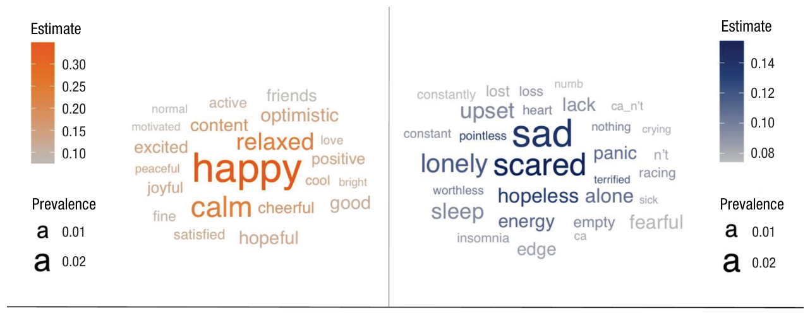
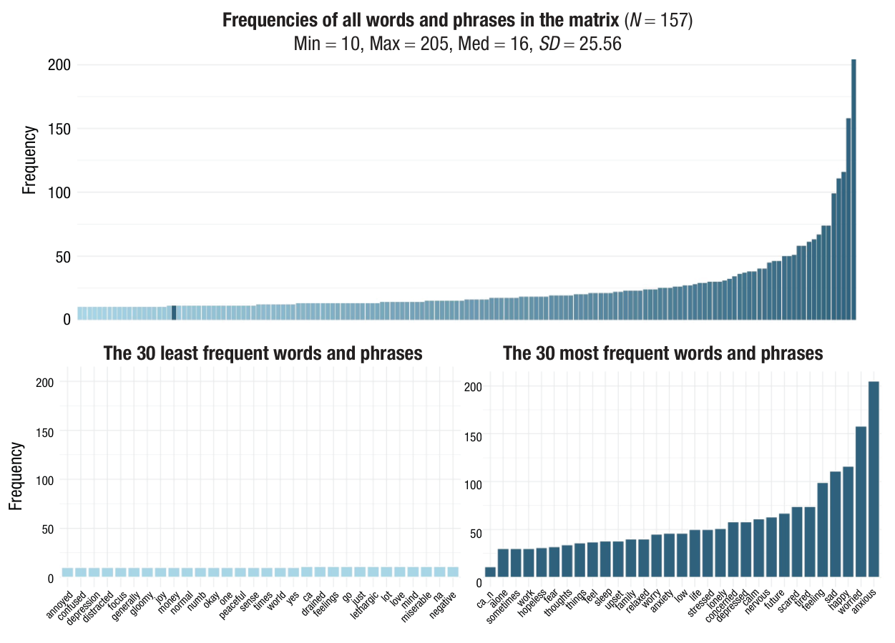
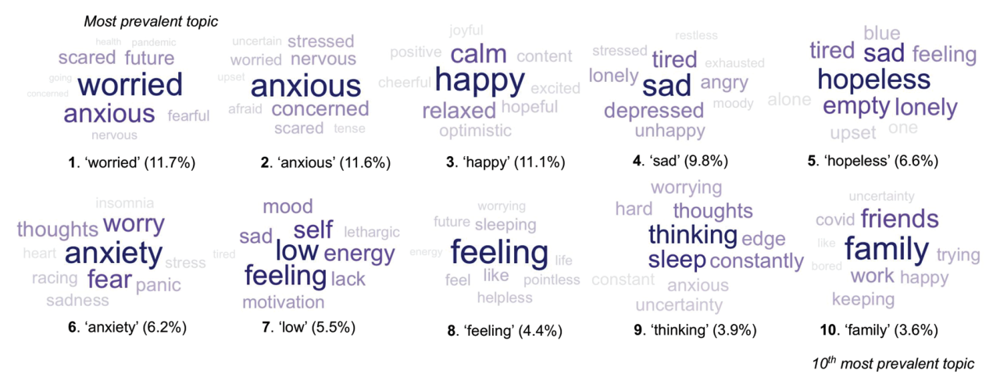
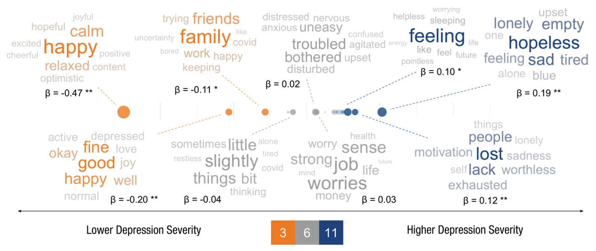
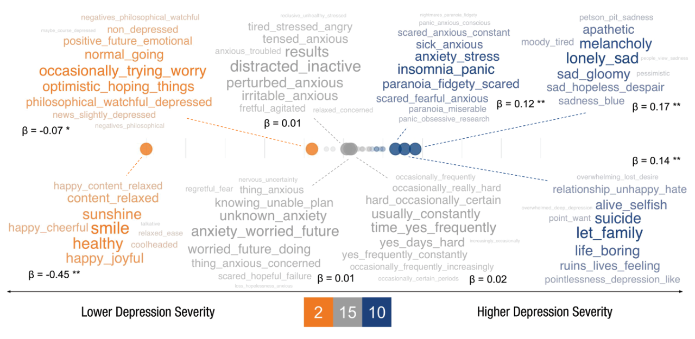
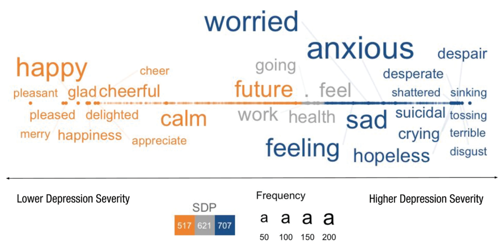
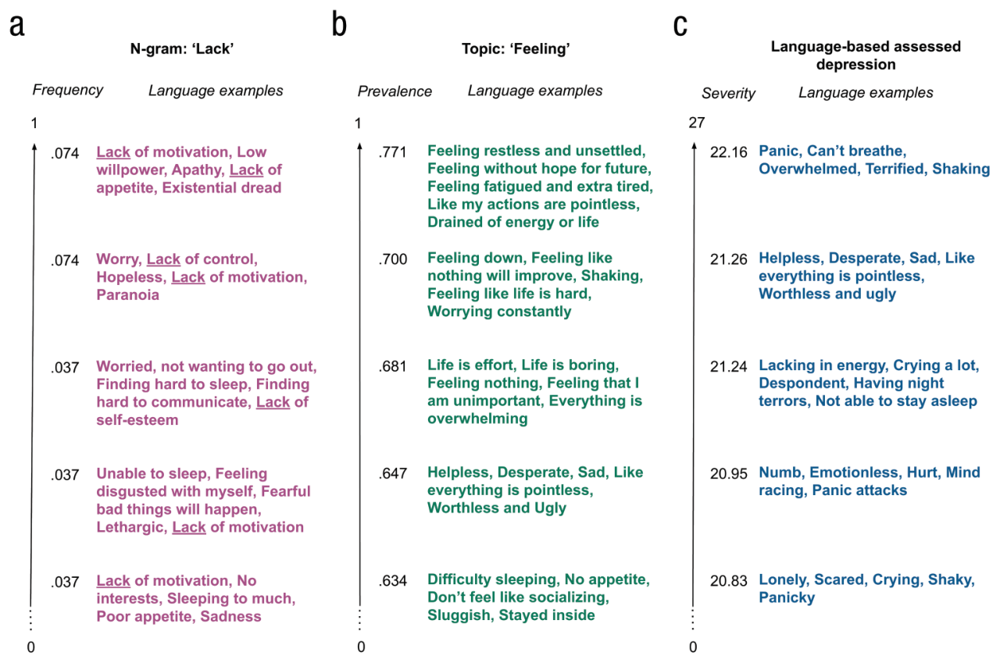
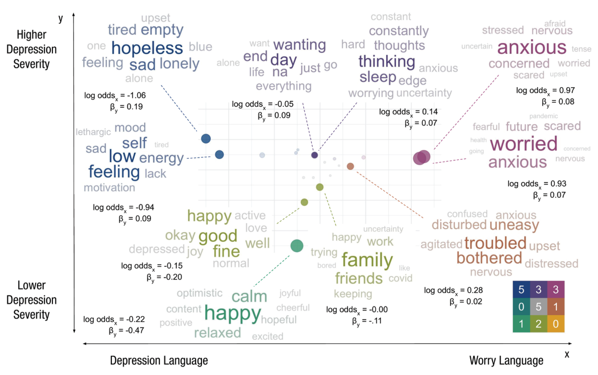
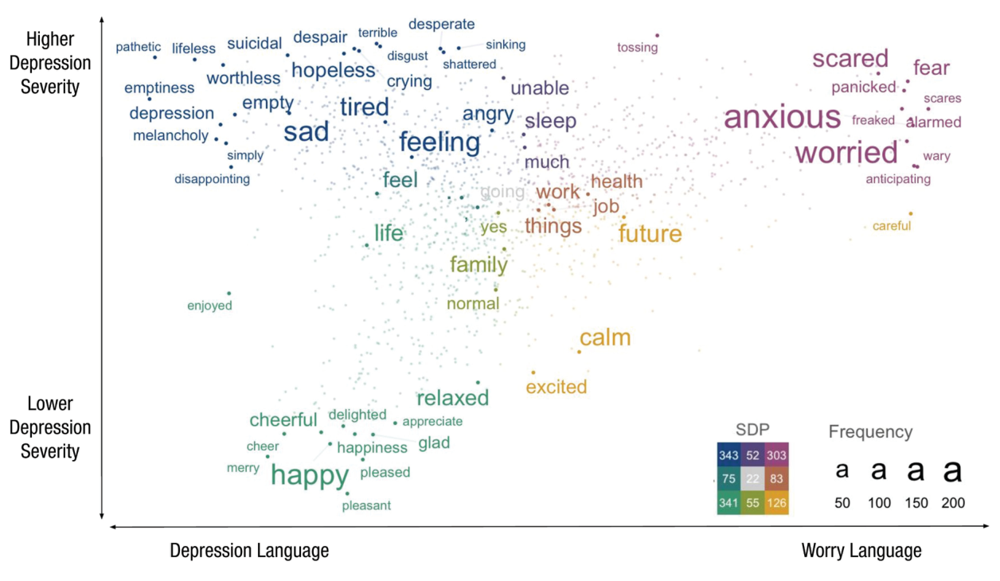
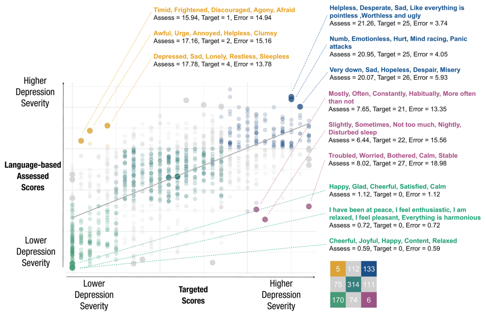

```{r, include = FALSE}
knitr::opts_chunk$set(
  collapse = TRUE,
  comment = "#>",
  eval = FALSE
)
```

<style>
table {
  font-size: 0.85em;
}
</style>

**Veerle C. Eijsbroek, August H. Nilsson, Leon Ackermann, Zhuojun Gu, Clara Wiebel, Adithya V. Ganesan, Katarina Kjell, H. Andrew Schwartz, and Oscar N. E. Kjell**

*This article is the full text of the open-access tutorial published in Advances in Methods and Practices in Psychological Science (2026, Vol. 9, No. 3, pp. 1–33), reproduced here with figures and copy-and-paste-ready code. Please cite the published article:*

> Eijsbroek, V. C., Nilsson, A. H., Ackermann, L., Gu, Z., Wiebel, C., Ganesan, A. V., Kjell, K., Schwartz, H. A., & Kjell, O. N. E. (2026). Multiple Methods for Visualizing Human Language: A Tutorial for Social and Behavioral Scientists. *Advances in Methods and Practices in Psychological Science, 9*(3), 1–33. [https://doi.org/10.1177/25152459261454622](https://doi.org/10.1177/25152459261454622)

*The article is distributed under the terms of the [Creative Commons Attribution 4.0 License](https://creativecommons.org/licenses/by/4.0/). For in-text reference details, see the [reference list of the published article](https://doi.org/10.1177/25152459261454622).*

## Abstract

Humans use language to communicate psychological experiences. Advancements in natural language processing have enabled researchers to quantitatively study and assess psychological states and behaviors through language. Insights from these language analyses are often best conveyed through visualizations. Data-driven visualizations of how language statistically relates to psychological dimensions can help interpret assessment scores, uncover meaningful patterns, and understand the intricate relationships between language use and mental states. Visualizations can be used to differentiate between related constructs (e.g., How does language related to depression versus anxiety differ?), understand the validity of assessment tools (e.g., Does the language related to high depression severity match with depression theory?), and explain language-based assessments (e.g., Which language is indicative of higher depression severity in a language-based assessment?). In this tutorial, we demonstrate how to transform language data into visual insights using the text and topics packages in R. We provide practical guidance on creating four types of visualizations based on different language-analysis techniques, examining how language-use patterns are statistically associated with psychological constructs. We visualize (a) individual words and phrases (n-grams), (b) topics (word clusters), (c) words in the word-embedding space, and (d) relevant language examples. The different visualizations offer complementary perspectives, visualizing linguistic elements from individual words to overarching topics and text examples. The underlying methods range from correlations between individual words to more advanced techniques, including topic modeling and large language models. By making these methods accessible, we aim to empower researchers to use language visualizations for meaningful, data-driven insights.

**Keywords:** language visualization, quantitative language analysis, natural language processing, topic modeling, large language models, R programming, open data, open materials

## Introduction

Language plays an important role in organizing emotions and thoughts, sharing them with others, and allowing people to comprehend the perspectives of others. Through language, people make sense of past experiences, plan for the future, and navigate relationships by cooperating, learning, and teaching (Pennebaker et al., 2003; Tausczik & Pennebaker, 2010). These diverse functions make language an integral part of human life. Analyzing language-use patterns can provide insights into how people express their states and traits and navigate their psychological experiences in diverse contexts (Boyd & Schwartz, 2021; Eichstaedt et al., 2021; Mihalcea et al., 2024).

### Visualizations of Human Language

Analyzing language-use patterns—how people talk about emotions, thoughts, or experiences—can provide valuable insights into psychological constructs and behaviors. Insights from language analyses are often best conveyed through visualizations. Language visualizations enable researchers to explore and interpret the relationships between language use and psychological dimensions (e.g., Eichstaedt et al., 2021; Schwartz et al., 2013). They can complement traditional statistical analyses, enhance their interpretability and applicability, and uncover insights that might otherwise go unnoticed (e.g., O. Kjell, Giorgi, Schwartz, & Eichstaedt, 2023; Nilsson et al., 2024). With numerous language-visualization options available, in this tutorial we aim to streamline quantitative techniques for a broader audience in a user-friendly manner through the R programming language. Our aim is to support social and behavioral scientists in creating language visualizations and to advance the use of language visualizations for meaningful data-driven insights.

### Advancements in Quantitative Language Analysis

Visualizations of language can rely on different language-analysis techniques. There are different approaches to quantitative language analysis in psychology, which can roughly be divided into theory-driven and data-driven approaches (also known as "closed-vocabulary" and "open-vocabulary" approaches, respectively; Eichstaedt et al., 2021). A widely used theory-driven approach is linguistic inquiry and word count (LIWC), which calculates the relative frequencies of predefined, psychologically relevant word dictionaries (e.g., negative-emotion words, social words) across texts. This enables the analysis of the relationships between word-dictionary frequencies and psychological states (Francis & Booth, 1993; Pennebaker et al., 2001). However, data-driven approaches allow researchers to move beyond predefined categories to discover patterns directly from the data. This often begins with n-grams, which are individual words or phrases (Schwartz et al., 2013). By identifying which specific words or phrases are statistically associated with a variable, researchers can capture linguistic markers that dictionaries might overlook. To manage the vast variety of individual words, topic modeling (e.g., latent Dirichlet allocation [LDA]; Blei et al., 2003) groups co-occurring words into clusters, or "topics." These word clusters can capture broader semantic themes that are often more stable and interpretable than individual words.

Over the past decade, advancements in natural language processing and machine learning (Devlin, 2019; Vaswani, 2017) have further transformed the field. These technologies have made it possible to transform language into psychologically meaningful numerical representations called "word embeddings," which can capture the complexities of language—such as context and word order—in a structured, quantified manner (Demszky et al., 2023; O. Kjell, Kjell, & Schwartz, 2024; Mihalcea et al., 2024). These advancements have improved the accuracy of language-based assessments of psychological constructs (O. N. E. Kjell et al., 2022), which have demonstrated high measurement validity in assessing personality traits (e.g., Eichstaedt et al., 2021), mental-health problems (e.g., K. Kjell et al., 2021), and well-being (e.g., Sametoğlu et al., 2023). As these techniques grow more sophisticated, the role of visualization becomes critical, providing a necessary bridge between numerical outputs and interpretable psychological insights.

### Applications of Language Visualizations

Beyond quantitatively analyzing language to produce assessment scores (e.g., depression-severity scores based on language) or behavioral predictions (e.g., sick-leave predictions derived from text), language visualizations have emerged as a valuable complement to explore and elucidate individuals' experiences. There are numerous reasons for using language visualizations, such as to better understand language data itself or to describe the measured constructs in more detail. Visualizations can support the interpretation of assessment scores, reveal meaningful patterns, and clarify how language relates to psychological states and behaviors. They offer intuitive ways to explore and communicate the output of language-based assessments, complementing quantitative scores with richer, more interpretable insights. By visualizing language use based on statistically significant relationships, researchers can better understand individuals' psychological experiences and evaluate the validity of the tools used to assess them. For example, language analyses complemented by visualizations have provided insights into how individuals' personality traits, gender, and age are expressed in social media language (e.g., Park et al., 2016; Schwartz et al., 2013) or how mental-health descriptions vary with the severity of mental-health issues (e.g., Gu et al., 2025; O. N. E. Kjell et al., 2019). Table 1 provides more examples of language analyses and visualizations in research settings.

**Table 1. Typical Applications of Different Language Visualizations in Psychological Research**

| Application | Example | Visualization/analysis type |
|-----------|----------------------------|-----------|
| Understand and describe language data | Analyzing and visualizing individuals' described activities in relation to their well-being has illustrated distinct patterns in how people articulate their behaviors (Nilsson et al., 2022). Words positively related to well-being depicted active and social activities ("football," "meditation," "friends"), whereas words negatively associated with well-being indicated imbalance ("too," "much," "enough"). | Words in word-embedding space |
| | Topic modeling in free-text responses has been used to examine which coping strategies individuals employed during the COVID-19 pandemic, such as "friends," "family," "walking," "reading," and "gardening" (Wright et al., 2022). | Topics |
| Understand and describe psychological constructs | Analyzing and visualizing mental-health descriptions have shown that depression is associated with words like "sad" and "alone" and that anxiety is linked to words like "nervous" and "tense" (O. N. E. Kjell et al., 2019). The visualizations also captured variations in mental-health descriptions by depression and anxiety severity. | Words in word-embedding space |
| | Analyses of social media language have highlighted differences in self-expression in relation to gender, age, and personality (Eichstaedt et al., 2021; Park et al., 2016; Schwartz et al., 2013). Visualizing the language in Facebook posts showed, for example, how individuals with high extraversion ("party," "lol," "bestie") versus low extraversion ("computer," "internet," "anime") communicate online (Schwartz et al., 2013). | LIWC; Words and phrases; Topics |
| Differentiate between closely related constructs | Language analyses accompanied by visualizations have identified distinct and overlapping language patterns across closely related constructs, such as how people describe "depressive" versus "anxious" feelings (Gu et al., 2025) and experiences of "harmony in life" versus "satisfaction with life" (O. N. E. Kjell et al., 2016). | Words in word-embedding space |
| | Topic modeling in combination with identifying and visualizing examples of open-ended responses helped reveal how people perceive "harmony" versus "balance" in their lives (Lomas et al., 2026), and words and topics in social media posts helped differentiate between feelings of "depression" and "loneliness" (T. Liu et al., 2022). | Topics; Language examples; Words and phrases |
| Identify drivers of relationships | Word-frequency analyses and topic modeling have been used to explore the relationship between immigration and mental health. Visualizations of language patterns in social media posts revealed differences in topics related to mental health between immigrants (e.g., "employment" and "affordability") and nonimmigrants (e.g., "family" and "friends") and before and after immigration (Mittal et al., 2023). | LIWC; Words and phrases; Topics |
| Connect states and behaviors | Analyses and visualizations of words in the word-embedding space have been used to explore how psychological states relate to behaviors, for example, how the level of well-being relates to cooperative actions (O. Kjell et al., 2021). | Words in word-embedding space |
| | Topic modeling in text responses has shown how well-being relates to different types of alcohol-drinking behaviors, such as drinking alone ("anxious," "frustration"), problematic drinking ("urge"), and drinking more than usual ("celebration"; Matero et al., 2024). | Topics |
| Face validity of language-based assessments | Visualizations can support face validity in language-based assessments. For instance, visualizations of words in the word-embedding space have provided face validity for language-based assessments of depression and anxiety (Gu et al., 2025). | Words in word-embedding space |
| Face validity of traditional self-report measures | Language analyses can clarify the constructs measured by traditional rating scales by identifying and visualizing linguistic patterns and comparing those with theoretical expectations or human interpretations. For example, visualizations of words in the word-embedding space have provided face validity evidence for the Harmony in Life scale (O. N. E. Kjell et al., 2016). | Words in word-embedding space |
| | Topic modeling, word-dictionary frequencies, and examples from open-ended responses have clarified how people interpret the widely used Cantril ladder scale for measuring well-being, showing that the ladder symbol elicits thoughts about "power" and "wealth" (Nilsson et al., 2024). | LIWC; Topics; Language examples |

*Note: LIWC = linguistic inquiry and word count.*

**Table 2. Similarities and Differences Between the Four Types of Visualizations and Their Underlying Language-Analysis Techniques**

| Visualization | Analysis unit | Main analysis | Association metric/effect size | Level of language output |
|-------------------|-------------------|-------------------|------------------------|-------------------|
| Individual words and phrases | Relative frequencies of n-grams | Multiple regression | Pearson r correlation/standardized β/log ratio | Individual words and phrases |
| Topics (word clusters) | Relative frequencies of clusters | Multiple regression | Pearson r correlation/standardized β/log ratio | Clusters of words |
| Words in the word-embedding space | Word embeddings of words and sentences | Embedding projection | Dot product projection | Individual words |
| Text examples | Relative frequencies of n-grams or topics/word embeddings of sentences | Frequencies/ridge regression | Frequencies/log ratio/(standardized) absolute error | Language fragments |

### Aims

Previous research has provided comprehensive comparisons between the outputs and applications of different language-analysis techniques. Schwartz and Ungar (2015) illustrated the utility of data-driven techniques in analyzing large-scale social media data, revealing how linguistic patterns reflect psychological traits, emotions, and demographics. Eichstaedt et al. (2021) provided a detailed review of theory-driven and data-driven approaches. They compared predefined word-dictionary analyses (e.g., LIWC) with data-driven methods based on topic modeling or large language models and advocated for hybrid techniques to balance interpretability and discovery. Egger and Yu (2022) extended the discourse by evaluating the practical implications of diverse topic-modeling methods, ranging from traditional dictionary-based approaches to modern machine-learning models, with a focus on their accuracy, scalability, and suitability for various constructs.

Although these theoretical and empirical comparisons have identified the diverse applications and complementary nature of these techniques, practical guidance for their implementation remains limited. In particular, although existing literature highlights opportunities for visualization, researchers often lack the technical guidance to create them. In this tutorial, we aim to fill this gap by providing practical guidance on different quantitative language-analysis techniques specifically tailored for making visualizations. In the tutorial, we use R, specifically, the topics package (Ackermann et al., 2024) and the text package (O. Kjell, Giorgi, & Schwartz, 2023), and provide step-by-step guidance for making a range of data-driven language visualizations. Drawing on the aforementioned literature, we offer user-friendly tools, sensible defaults, and practical "rules of thumb" intended as helpful starting points rather than strict prescriptions. This guidance is designed to support researchers in making informed decisions and thoughtful applications without requiring deep technical expertise.

## Tutorial

In this tutorial, we demonstrate how to make four types of data-driven visualizations of linguistic elements, ranging from individual words to overarching topics (i.e., word clusters) and complete-text examples. The underlying techniques all involve differential language analysis (Schwartz et al., 2013, 2017), and we examine how language-use patterns are statistically associated with a psychological construct or behavior. Specifically, we visualize (a) individual words, (b) topics (word clusters), (c) words based on their numerical representations in the word-embedding space, and (d) relevant text examples highlighting the qualitative aspects of language as opposed to quantitative assessments (Table 2). The visualizations complement each other, providing unique insights while highlighting common patterns. Strong effects, such as differences in emotional valence (e.g., negative vs. positive emotion), are typically evident across all methods. However, each technique also reveals distinct aspects of the language data, enriching the overall analysis.

We employ methods ranging from correlations between word frequencies to more advanced techniques based on topic modeling and large language models. Each visualization is accompanied by a technical description of the functions used in R, including their outputs and parameters (for which rules of thumb are provided). At the end of the tutorial, we discuss aspects to consider when interpreting language visualizations, including ethical considerations.

### Tools

There are many tools for analyzing and visualizing language, including DLATK (Schwartz et al., 2013, 2017) and PyText (Aly et al., 2018). In this tutorial, we use the text (O. Kjell, Giorgi, & Schwartz, 2023) and topics (Ackermann et al., 2024) packages in R, both designed to streamline language analysis and visualization for the social and behavioral sciences. These open-source packages on CRAN provide interfaces and functionalities to analyze raw text data and transform the results into statistically meaningful visualizations, enabling researchers to effectively explore linguistic patterns, psychological constructs, and their relationships. The code below shows how to install the topics and the text packages. For more detailed installation instructions and troubleshooting, see [www.r-text.org](https://www.r-text.org) and [www.r-topics.org](https://www.r-topics.org). The time required to install the packages varies widely depending on the operating system, internet speed, and whether the necessary system dependencies are already installed, but it typically falls between 2 min and 30 min.

```{r}
# Install the topics package
# The topics package uses JAVA, which is a programming language.
# ! Please start by downloading and installing it from www.java.com/en/download/.
# Then open R and run:
install.packages("topics")

# Increase memory allocation for performing JAVA-based operations in R
# This enhances performance and reliability in memory-intensive tasks.
options(java.parameters = "-Xmx5000m")
library(topics)

# Install the text package
install.packages("text")
library(text)

# The first time, you also have to install text-required Python packages
# and initialise the Python environment.
textrpp_install()
textrpp_initialize()

# Install other packages
# This package is needed to prepare the dataset
install.packages("dplyr")
library(dplyr)
```

The code to reproduce all tutorial steps is available via the OSF, at [https://osf.io/z5cb2/](https://osf.io/z5cb2/). The statistical analyses and the figures were conducted and created using RStudio and R (Version 4.6.0; R Core Team, 2026), including the R packages dplyr (Version 1.2.1; Wickham et al., 2023), topics (Version 1.0; Ackermann et al., 2024), and text (Version 1.9; O. Kjell, Giorgi, & Schwartz, 2023). The code produces complete figures and the separate visualization components (i.e., word clouds and legends) that can be saved and uploaded to presentation programs of choice, such as PowerPoint or Google Drawings, for editing and combining into complete figures (for a step-by-step overview, see the Supplemental Material).

### Example data

We use a data set that is part of the topics package: `dep_wor_data`. The data were collected in the study of Gu et al. (2025) that measured depression (major depressive disorder [MDD]) and anxiety (generalized anxiety disorder [GAD]) based on open-ended responses using language-based assessments. Participants were recruited online from Prolific (Palan & Schitter, 2018), including a screened population (i.e., self-reported diagnosis of MDD or GAD) and an unscreened population. Participants (N = 500) were asked, "Over the last 2 weeks, have you been depressed or not?" and "Over the last 2 weeks, have you been worried or not?" They were instructed to describe their level of depression and worry by writing five descriptive words or phrases (`Depphrase` and `Worphrase`; see Box 1; for details, see Gu et al., 2025). The data also include rating-scale scores for depression severity (`PHQ9tot`, the Patient Health Questionnaire-9 [PHQ-9]; Kroenke et al., 2001) and participants' self-reported `Age` (rounded to the nearest 5) and `Gender` (0 = female, 1 = male). Other variables in this data set are described in the Try It Yourself section at the end of the tutorial.

> **Box 1. Example of an Open-Ended Question Used for Assessing Depression**
>
> Over the last 2 weeks, have you been depressed or not?
>
> Please answer the question by typing five descriptive words or phrases below that indicate whether you have been depressed or not. For example, if you have been depressed, then write more and stronger words or phrases describing this, and if you have not been depressed, then write more and stronger words or phrases describing that.
>
> Write descriptive words or phrases relating to those aspects that are most important and meaningful to you.
>
> Write one to five words in each box.

The `Depphrase` and `Worphrase` text variables include five to 26 words per response (Mdn = 7, M = 9.47, SD = 5.19). For individuals interested in making visualizations of longer text entries (ranging from 250 to 750 words per essay), we present these analyses based on students' stream-of-consciousness essays (Pennebaker & King, 1999) in the Supplemental Material available online.

The code below demonstrates how we prepared the `dep_wor_data` data set for visualizations. In many data sets, you may encounter multiple text columns. A common approach is to reshape these wide-format data sets into a long format (Wickham, 2014), in which all text variables are consolidated into a single column (here, `Language`) and the remaining columns are duplicated accordingly (`PHQ`, `Age`, and `Gender`). In addition, creating indicator (dummy) variables to identify the original source of each text entry can facilitate comparisons between different text sources (here, `DepWor` to indicate if it is a response to the depression or worry question).

```{r}
# Examine the dataset
dep_wor_data

# Prepare the dataset
# Combine the depression and worry responses into one language column
Language <- c(
  dep_wor_data$Depphrase,
  dep_wor_data$Worphrase)

# Create an indicator variable for depression language (0) and worry language (1)
DepWor <- c(
  rep(0, length(dep_wor_data$Depphrase)),
  rep(1, length(dep_wor_data$Worphrase)))

# Add corresponding depression severity scores, age, and gender.
PHQ <- rep(dep_wor_data$PHQ9tot, 2)
Age <- rep(dep_wor_data$Age, 2)
Gender <- rep(dep_wor_data$Gender, 2)

# Combine the language, indicators, rating scales, age, and gender into a tibble.
dep_wor_language <- tibble(
  Language, DepWor, PHQ, Age, Gender)

# Show the first 10 rows
head(dep_wor_language)
```

Preprocessing of the data (e.g., lower casing, punctuation removal) is handled by functions from the text and topics packages with different parameters (e.g., `lower = TRUE`, `remove_punctuation = TRUE`), as further explained in the tutorial.

### Visualizations of words and phrases (n-grams)

Here, we visualize individual words and phrases (also called "n-grams") in relation to a variable of interest. Specifically, we visualize individual words (from the depression and worry responses) positively and negatively associated with depression severity (PHQ-9 ratings) through two differential word clouds. The analyses underlying this visualization involve structuring meaningful n-grams based on word frequency and co-occurrence and testing the relationship between the n-gram frequencies and PHQ-9 ratings using regression. The visualization is created with three functions of the topics package, including (a) `topicsGrams()`, which structures meaningful n-grams; (b) `topicsTest()`, which significance tests the n-grams in relation to the variable of interest; and (c) `topicsPlot()`, which visualizes the significant n-grams. Table 3 provides rules of thumb and recommendations for setting the parameters across functions.

**Table 3. Rules of Thumb and Recommendations for Setting Parameters in the Functions of the topics and text Packages**

| Parameter | Functions | Recommendation | Reference |
|----------------|------------------|--------------------------------------------------|----------------|
| `ngram_window` | `topicsGrams()`, `topicsDtm()` | Consider using sequences of one to maximum three words to retain meaningful co-occurrences, i.e., 1-grams, 2-grams, and 3-grams (this is the default). Beforehand, make sure the text is clean and adequately divided into individual words to be able to create well-structured n-grams or a robust document-term matrix. | Schwartz et al. (2013) |
| `stopwords`, `remove_words` | `topicsGrams()`, `topicsDtm()`, `textProjectionPlot()` | Consider removing stopwords if they are not relevant to the analysis or research questions. The default is the snowball lexicon consisting of 175 stopwords. | Porter (2001) |
| `occurance_rate` | `topicsGrams()`, `topicsDtm()` | Reduce the number of n-grams to be tested based on the statistical power available. It is common to restrict analyses to words used by at least a certain fraction of the sample. A rule of thumb is to limit the analysis to words that were used by at least 1% to 5% of the participants. | Atkins et al. (2012); Eichstaedt et al. (2021) |
| `pmi_threshold` | `topicsGrams()`, `topicsDtm()` | Use the PMI to filter meaningful n-grams. A rule of thumb is to set the PMI threshold to 2 or 3 for relatively large data sets and between 3 and 6 for smaller data sets. | Schwartz et al. (2013); Church and Hanks (1990); Lin (1998); Eichstaedt et al. (2021) |
| `removal_mode`, `removal_rate_most`, `removal_rate_least` | `topicsGrams()`, `topicsDtm()`, `topicsDtmEval()` | LDA does not handle common words very well (i.e., the head of the Zipfian distribution). Consider setting a frequency threshold (`removal_mode = "frequency"`) to ensure there is not a big gap in frequency between the most frequent word and the second most frequent word (i.e., remove the most frequent words with `removal_rate_most`). When creating visualizations of topics using LDA, we recommend evaluating the resulting document-term matrix and adjusting or refining the parameters based on the evaluation results. Avoid iterative back-and-forth testing based on the significance tests or the visualizations themselves because this inflates Type I error rates. | Piantadosi (2014); Weston et al. (2023); Roberts et al. (2019) |
| `num_topics` | `topicsModel()` | A rule of thumb is to start with approximately one topic per 50 documents as a baseline. Adjust the number of topics based on results: If topics overlap too much, reduce the number of topics, and if topics are incoherent, increase the number of topics. Avoid overfitting by limiting time spent refining topics: Assess overlap coherence and adjust as needed. In addition, avoid iterative back-and-forth between testing the number of topics and significance testing because this can inflate Type I error rates. The number of topics is also dependent on the nature of your data set: Fewer topics might be needed for probed language responses if every participant answered the same question, whereas social media language might be more diverse and cover more topics. | Weston et al. (2023); Roberts et al. (2019) |
| `num_iterations` | `topicsModel()` | From our experience, the default (1,000 iterations) usually works well. | |
| `embedding_model`, `model` | `textTopics()`, `textEmbed()` | Use a pretrained large language model with cosine similarity properties to ensure meaningful semantic comparisons between the word embeddings, such as DistilRoBERTa ("distilroberta"; Sanh et al., 2019) in `textTopics()` and Mixedbread ("mixedbread-ai"; Li & Li, 2023) or RoBERTa ("roberta-base"; Y. Liu et al., 2019) in `textEmbed()`. | Grootendorst (2022); O. Kjell et al. (2023) |
| `p_adjust_method` | `topicsTest()`, `textTopicsTest()` | Because many tests are computed (e.g., between every topic and the variable[s] of interest), it is essential to report significance based on correction for multiple comparisons. The default is the false-discovery-rate procedure ("fdr"). | Benjamini and Hochberg (1995) |
| `controls` | `topicsTest()`, `textTopicsTest()` | Controlling for sociodemographic characteristics (e.g., age and gender) and visualizing these controls can help to mitigate biases in the interpretations of language analyses. | |
| `color_scheme`, `bivariate_color_codes`, `distribution_color` | `topicsPlot()`, `textTopicsWordcloud()`, `textProjectionPlot()`, `textExamples()` | To make a visualization accessible, try to choose colors that intuitively align with the concept or association and take into account accessibility concerns (e.g., color blindness). For example, see the Okabe–Ito palettes that follow the Color Universal Design. | Okabe and Ito (2002, 2008) |
| `word_font` | `topicsPlot()`, `textTopicsWordcloud()`, `textProjectionPlot()` | Choose an accessible font type to accommodate readability (default is "sans"). We recommend Sans Serif because it is minimal and has a relatively high height for lower-case letters, beneficial for readability. | |
| `max_size`, `width`, `height`, `word_size_range` | `topicsPlot()`, `textTopicsWordcloud()`, `textProjectionPlot()` | Make sure that the size of the words and topics is sufficient relative to the complete figure size to accommodate readability. Other parameters are available for adjusting the size of the titles, legends, and axes. | |

*Note: For explanations and options for all parameters (e.g., aesthetics parameters for adjusting layout), see [www.r-topics.org](https://www.r-topics.org) and [www.r-text.org](https://www.r-text.org). PMI = pointwise mutual information; LDA = latent Dirichlet allocation.*

**Structure meaningful n-grams.** Participants' responses are first split into individual words and phrases (n-grams) using the `topicsGrams()` function. N-grams are sequences of words: 1-grams are single words, and 2- or 3-grams are sequences of words combined with underscores (e.g., "happy_birthday" instead of "happy" and "birthday"). The size of n-grams is set with the `ngram_window` parameter (here, set to sequences of one to three words).

Rather than including all possible 2- and 3-grams, it is possible to retain only phrases from which the individual words are more likely to occur together than to occur independently. This is achieved using the `pmi_threshold` parameter (set to 5 here), based on pointwise mutual information (PMI; Church & Hanks, 1990; Lin, 1998; Schwartz et al., 2013). The PMI quantifies the association between two events—in the context of n-grams, these events correspond to words that co-occur. When two words co-occur more often than expected by chance, the PMI of the phrase will be larger than 0. When the two words occur together purely by chance (i.e., they are independent), the PMI of the phrase will be 0. Phrases with a PMI greater than 1 occur at least twice as likely as expected by chance. Using the PMI is a common method for removing weak or less meaningful associations and limiting the correction for multiple comparisons in subsequent statistical tests (Lin, 1998; Schwartz et al., 2013; for rules of thumb, see Table 3).

To further ensure focus on meaningful n-grams and limit the corrections for multiple comparisons, it is possible to restrict the analyses to words and phrases used by a minimum proportion of the participant sample (e.g., see Atkins et al., 2012; Eichstaedt et al., 2021) using the `occurance_rate` parameter (here, set to 0.01, which limits the analysis to n-grams that appear in at least 1% of individuals' responses; for rules of thumb, see Table 3). The n-grams are filtered based on their frequency of occurrence to include only those n-grams that appear in a certain proportion of the responses, calculated by dividing the number of responses that contain a specific n-gram by the total number of responses.

In addition, it is possible to remove words using the `stopwords` parameter. Here, you can specify a list of common words (e.g., "the," "and," "is") that you want to exclude from the analysis because they are not expected to be meaningful in relation to the variable of interest (e.g., depression severity). The default option is the predefined list of 175 stopwords from the snowball lexicon (Porter, 2001). By removing stopwords, the function focuses on more meaningful words and phrases, enhancing the clarity and relevance of the resulting visualizations.

Before the responses are structured into n-grams, the responses are preprocessed according to parameter settings (which defaults to TRUE), including `lower` (texts are lowercased), `remove_punctuation` (punctuation is removed), and `remove_numbers` (numbers are removed).

```{r}
# Structure and filter n-grams
# Structure the language into n-grams
ngrams <- topicsGrams(
  data = dep_wor_language$Language,
  ngram_window = c(1,3),                                        # Allow for n-grams of 1 to 3 words
  stopwords = stopwords::stopwords("en", source = "snowball"),  # Remove stopwords
  pmi_threshold = 5,                                            # Set the PMI threshold to 5
  occurance_rate = 0.01)                                        # Set the occurrence rate to 1%
# Output: Most frequently occurring n-grams across the dataset
```

The output of `topicsGrams()` is a list of the most frequently occurring n-grams across the data set, including their frequency and prevalence and the number of documents. The frequency indicates the number of times an n-gram appears in the data set, the prevalence indicates the frequency of an n-gram relative to the total number of n-grams in the data set, and the number of documents indicates the number of distinct responses in which an n-gram appears.

**Significance test the n-grams.** We examine which n-grams are statistically related to a variable of interest (here, depression severity) using the `topicsTest()` function (this function can also be used to statistically test word clusters [topics], which is described in the next visualization). The output of the `topicsGrams()` function is submitted to the `ngrams` parameter, and the variable of interest is submitted to the `x_variable` parameter. We control for age and gender using the `controls` parameter and correct for multiple comparisons using the `p_adjust_method` parameter (here, the default method, false-discovery rate [FDR], "fdr"; Benjamini & Hochberg, 1995). The method for testing the statistical relationship is specified by the `test_method` parameter. The default in `topicsTest()` is to perform multiple regression ("linear_regression" when the outcome is continuous or "logistic_regression" when the outcome is binary). In this case, we conduct a multiple regression using

$$z(depression\_severity) = \beta_0 + \beta_1 z(ngram_1\_freq) + \beta_2 z(gender) + \beta_3 z(age) + \varepsilon$$

where *z(depression_severity)* is the standardized depression rating scale; *z(ngram1_freq)* is the standardized frequency of the n-gram; *β0* is the intercept of the regression model; *β1*, *β2*, and *β3* are the coefficients (standardized beta coefficients) representing the unique contributions of the tested n-gram, age, and gender, with depression severity, respectively; and *ε* is the error term.

```{r}
# Significance test the n-grams
# Examine which words and phrases are significantly related to depression severity
ngrams_test <- topicsTest(
  data = dep_wor_language,
  ngrams = ngrams,
  test_method = "linear_regression", # Apply linear regression
  x_variable = "PHQ",                # Depression severity as target
  controls = c("Age", "Gender"),     # Control for age and gender
  p_adjust_method = "fdr")           # Correct for multiple comparisons
# Output: Results of statistical test of the relationship between the n-grams and depression severity
```

This regression produces standardized beta coefficients, which can be interpreted as a controlled (partial) correlation, indicating the unique association between each predictor and the standardized n-gram frequency. For example, the beta of *z(depression_severity)* in this model reflects the unique association of depression severity with n-gram 1 controlling for age and gender. Other variables in the output list include the (adjusted) p values (i.e., corrected for multiple comparisons) and the prevalence of each n-gram.

**Visualize the significant n-grams.** Finally, we create the visualization by plotting the differential word clouds using the `topicsPlot()` function. Here, the n-grams of `topicsGrams()` are submitted to the `ngrams` parameter, and the significant test results of `topicsTest()` are submitted to the `test` parameter. The n-grams are selected based on the strength of the relationship with depression severity (β) through the `ngram_select` parameter (default is estimate but can be changed to select based on prevalence). The colors of the n-grams in the two word clouds are set with the `color_scheme` parameter (here, orange indicating a negative association and blue indicating a positive association with depression severity; for rules of thumb, see Table 3). The function also includes other parameters to adjust, for example, the font type (`word_font`) and size (`max_size`).

```{r}
# Visualize the significant n-grams
# Plot differential word clouds of words and phrases related to depression severity
ngram_plots <- topicsPlot(
  ngrams = ngrams,
  test = ngrams_test,
  color_scheme = c(
    "#d0d0d0", "#ff7c00",       # Colour indicating negative association
    "#d0d0d0", "#00508c"))      # Colour indicating positive association
# Output: Two word clouds, one negatively and one positively associated with depression severity
ngram_plots
```



*Fig. 1. Differential word clouds of words associated with (left) lower (orange) and (right) higher (blue) depression severity. The font size represents word prevalence, calculated as the relative frequency of each word in the data set (i.e., the number of times the word appears divided by the total number of words). The color gradient reflects the estimate, the standardized beta coefficient indicating the strength of the association with depression severity, controlling for age and gender. The color type reflects the direction of the association: Orange = significantly associated with lower depression severity (negative β); blue = significantly associated with higher depression severity (positive β). Only significant words are visualized; p values are corrected for multiple comparisons using the false-discovery-rate procedure (Benjamini & Hochberg, 1995). Participants: N = 500; responses: N = 1,000. Figure 1 was made using the topics package in R and edited in Google Drawings.*

The output consists of two word clouds: one including the n-grams significantly negatively related to depression severity (`negative_association`) and one including the n-grams significantly positively related to depression severity (`positive_association`). The word clouds are accompanied by two legends: one indicating the strength of each n-gram's relationship with depression severity (β) via a color gradient and one indicating the prevalence of each n-gram by font size. The visualization components (i.e., word clouds and legends) can be saved and imported into programs of choice, such as PowerPoint or Google Drawings, to combine them and refine the figures and layout (for a step-by-step overview, see the Supplemental Material). The output also includes an overview plot of all components (`overview_plot`).

The differential word clouds (Fig. 1) show that low depression severity is significantly related to words such as "happy" (β = −0.34, p < .001) and "relaxed" (β = −0.24, p < .001) and that high depression severity is significantly related to "sad" (β = 0.14, p < .001) and "scared" (β = 0.15, p < .001). These words align with expectations of language indicative of high versus low depression severity, providing face validity. The size of the words represents the prevalence (i.e., the relative frequency of each word). The color of the words indicates the strength of the association between the word and depression severity. These estimates are standardized beta coefficients that reflect the unique association between depression severity and each word.

### Visualizations of topics (word clusters)

Here, we visualize topics (word clusters) in relation to a variable of interest. Topic visualizations cluster words into semantically meaningful themes, offering a higher-level summary of language patterns that may not be apparent from individual words alone. Specifically, we visualize topics (in the depression and worry responses) positively and negatively associated with depression severity (PHQ-9 ratings) through multiple topic word clouds.

The analyses underlying these visualizations involve extracting underlying topics from the responses using topic modeling and testing the relationship between these topics and the PHQ-9 ratings using regression. There exist different topic-modeling techniques, such as LDA (Blei et al., 2003), structural-topic modeling (STM; Roberts et al., 2014), and BERTopic (Grootendorst, 2022). They share the same aim of automatically identifying themes in text. LDA is a probabilistic model that can be used to uncover underlying topics in text collections by modeling texts as mixtures of topics and topics as distributions over words (Blei et al., 2003; Griffiths et al., 2007). STM is similar to LDA but extends the probabilistic modeling by allowing text-level metadata (e.g., time, authorship, or demographics) to influence the topic prevalence and content (Roberts et al., 2014, 2019), requiring more decisions and setup. BERTopic, in contrast, is a more recent method that instead of relying on word frequency and co-occurrence, leverages large language models to generate topic representations. This method uses word embeddings—numerical representations of word meaning derived from large language models. Topics are derived from clustering word embeddings to capture word meanings in a contextualized way (Grootendorst, 2022). In this tutorial, we focus on LDA and BERTopic because together, they illustrate two complementary perspectives: a foundational, more interpretable probabilistic approach and a more modern embedding-based method, respectively. For a more detailed comparison between different topic-modeling approaches, see Egger and Yu (2022); for an introduction to STM, see the stm package and tutorial (Roberts et al., 2019).

### Visualizations of topics using LDA

LDA topics are clusters of co-occurring words in a collection of texts or responses identified using the LDA algorithm. The identification and visualization of the LDA topics is conducted through five functions of the topics package: (a) `topicsDtm()`, which creates a matrix of the text data (here, the depression and worry responses); (b) `topicsModel()`, which employs the LDA algorithm to identify underlying topics in the matrix; (c) `topicsAssess()`, which applies the trained LDA model to assign relative frequencies of each topic on the specified language data; (d) `topicsTest()`, which significance tests the topic frequencies in relation to individuals' characteristics (here, depression severity); and (e) `topicsPlot()`, which visualizes the significant topics.

**Structure the data into a matrix.** We use the `topicsDtm()` function to structure participants' responses into a document-term matrix (DTM). A DTM represents the frequencies of the n-grams across all responses and serves as the primary input for the LDA algorithm. By transforming language responses into a structured matrix, the DTM enables the efficient application of algorithms such as LDA to uncover underlying topics. The matrix is constructed by processing the text data, which includes removing stopwords (using the `stopwords` parameter), structuring n-grams (with the `ngram_window` parameter), and filtering n-grams based on specified thresholds using the `pmi_threshold` and `occurance_rate` parameters, as described in the previous visualization. In addition, the same preprocessing parameters apply (e.g., `lower`, `remove_punctuation`, and `remove_numbers`).

```{r}
# Create a Document-Term Matrix (DTM)
# Structure the depression and worry responses into a DTM
topics_DTM <- topicsDtm(
  data = dep_wor_language$Language,
  ngram_window = c(1, 3),                                      # Allow for n-grams of 1 to 3 words
  stopwords = stopwords::stopwords("en", source = "snowball"), # Remove stopwords
  pmi_threshold = 5,                                           # Set the PMI threshold to 5
  occurance_rate = 0.01)                                       # Set occurrence rate to 1%
# Output: Matrix including the frequencies of most frequent n-grams across all responses
```

To understand and evaluate the created DTM, it can be inspected using the `topicsDtmEval()` function, which provides an overview of the frequencies of n-grams in the matrix (i.e., how many responses each n-gram appears in).

```{r}
# Evaluate the DTM
# Evaluate the frequencies of the n-grams in the created DTM
topics_DTM_Eval <- topicsDtmEval(topics_DTM)
# Output: List and plots of frequencies of the n-grams in the matrix
topics_DTM_Eval$frequency_plot            # Show all frequencies
topics_DTM_Eval$frequency_plot_30_most    # Show the 30 most frequent n-grams
topics_DTM_Eval$frequency_plot_30_least   # Show the 30 least frequent n-grams
```



*Fig. 2. The frequencies of the words and phrases in the document-term matrix. The document-term matrix was created, allowing for 1- to 3-grams, and includes a total of 157 words and phrases. (Top) Frequencies of all n-grams (i.e., in how many responses each n-gram appears), Mdn = 16 (SD = 25.6) responses. (Bottom, left) The 30 least frequent words and phrases, in which the least frequent appears in 10 responses (i.e., "annoyed"). (Bottom, right) The 30 most frequent words and phrases, in which the most frequent word appears in 205 responses (i.e., "anxious"). Participants: N = 500; responses: N = 1,000. Figure 2 was made using the topics package in R and edited in Google Drawings.*

The output is a list of words and their frequencies and plots of word frequencies (e.g., `frequency_plot_30_least` and `frequency_plot_30_most` visualize the 30 least and most frequent n-grams in the DTM, as shown in Fig. 2). Inspecting the output of this function can be used to fine-tune the parameters in `topicsDtm()`, such as adjusting the `pmi_threshold` or `occurance_rate` thresholds or adding stopwords. Removing stopwords (or other highly frequent words) is recommended because LDA does not handle common words very well: The frequency of the most frequent word should not differ too much from the frequency of the second most frequent word. It is possible to remove the most and/or least frequent words from the DTM by setting a frequency threshold using the `removal_mode` (including `removal_rate_most` and `removal_rate_least`) parameters in the `topicsDtm()` function (for rules of thumb, see Table 3; for applying these parameters when analyzing longer text entries, see the Supplemental Material).

**Identify topics using the LDA algorithm.** Once the DTM is established, we employ the LDA algorithm to identify underlying topics in the text data using the `topicsModel()` function.^[LDA is implemented by Mallet (McCallum, 2002), which is in R using Rmallet (Magnusson & Mimno, 2022).] LDA assumes that texts are mixtures of topics, and each topic is characterized by a distribution over words. Using techniques such as Gibbs sampling (Yao et al., 2009), an underlying topic structure is inferred by estimating (a) the topic prevalences for each response and (b) the word distributions for each topic. In essence, Gibbs sampling is a repetitive process that iteratively reassigns words to topics until the most likely overall topic structure emerges. Note that LDA requires prespecifying the number of topics, which can be challenging and may not always capture the actual underlying structure of the data (a rough rule of thumb is one topic per 50 responses; see Table 3). The DTM is submitted to the `dtm` parameter, and the LDA algorithm is applied to the DTM while optimizing for a specific number of topics (with the `num_topics` parameter; here, set to 20) and number of iterations (with the `num_iterations` parameter; default is 1,000; see Table 3). The result is a distribution of topics for each text response with each topic characterized by a distribution over words.

```{r}
# Train LDA model
# Identify topics in the DTM using the LDA algorithm
topics_model <- topicsModel(
  dtm = topics_DTM,
  num_topics = 20)   # Create 20 topics (based on 1000 responses)
# Output: List of topics identified by the trained LDA model
```

The output contains a summary of all topics, including their label, top terms, coherence, and prevalence. The label indicates the most dominant or representative word in the cluster, and the top terms show the most representative words for each topic (of which the number of words is set with the `num_top_words` parameter; default is 10). These variables help define what the topic is "about." The coherence metric indicates how semantically related the top terms in a topic are; higher values indicate more coherent and interpretable topics. These scores represent the average PMI across all pairs of words in a topic and range from 0 to 1. Finally, prevalence indicates the proportion of responses in which the topic appears (i.e., relative frequencies), as described in the previous visualization.

It is possible to visualize the most prevalent topics in the trained LDA model using the `topicsPlot()` function. Here, the LDA model is fit with the `model` parameter, and the `plot_n_most_prevalent_topics` parameter indicates the number of most frequent topics to visualize (set to 10 here). Figure 3 shows the 10 topics with the highest relative frequencies in the trained LDA model.

```{r}
# Visualize the most prevalent topics
# Plot word clouds of the most prevalent topics in the LDA model
prevalent_topics_plots <- topicsPlot(
  model = topics_model,
  plot_n_most_prevalent_topics = 10) # Plot the 10 most prevalent topics
# Output: Word clouds of the most prevalent topics in the trained LDA model
prevalent_topics_plots
```



*Fig. 3. The 10 most prevalent topics identified by the latent Dirichlet allocation (LDA) model. Topics were generated using LDA (Blei et al., 2003) trained with 1- to 3-grams and set to extract 20 topics in total. Top 10 terms are shown for each topic. The topic labels are the most dominant or representative words in each cluster and can be found in the output of the `topicsModel()` function. The percentages next to each topic label indicate the topic's prevalence, defined as the proportion of responses in which the topic appears. In each topic cluster, the font size and color gradient reflect how representative each word is of that topic—that is, the word's probability of appearing within the topic. This corresponds to the φ (phi) parameter in the LDA model: φ = P(word | topic), which indicates the prevalence of words within each topic. Participants: N = 500; responses: N = 1,000. Figure 3 was made using the topics package in R and edited in Google Drawings.*

**Apply the LDA model to assess topic prevalence.** Next, the trained LDA model is applied to estimate the relative frequencies of the topics (i.e., their prevalence) in the participants' responses using the `topicsAssess()` function. Here, the output of `topicsModel()` is submitted to the `model` parameter, and the responses are submitted to the `data` parameter.

```{r}
# Apply the LDA model to identify topics
# Assess topic prevalences in the responses with the trained LDA model
topics_assess <- topicsAssess(
  model = topics_model,
  data = dep_wor_language$Language)
# Output: Table including the estimated relative frequencies of each topic in each response
```

The output is a table showing the estimated relative frequencies for each topic. The rows represent the language responses, the columns represent the topics, and the values indicate the proportion of each topic in the corresponding language response. It is also possible to submit new text data to the `data` parameter (i.e., not used for training the LDA model). Applying the model to "unseen" language is useful for evaluating the model's generalizability and applying the discovered topics to additional data. The function ensures that the new data are compatible with the existing DTM format and infers their topic distributions.

**Significance test the topics.** To examine which topics are statistically related to the variable of interest (here, depression severity), we use `topicsTest()` as previously described. Here, the estimated frequencies of `topicsAssess()` are submitted to the `preds` parameter, and the LDA model of `topicsModel()` is submitted to the `model` parameter. It is also possible to test and visualize the topics in relation to two variables of interest (see Two-Dimensional Visualizations of Language section).

```{r}
# Significance test the LDA topics
# Examine which topics are significantly related to depression severity
topics_test <- topicsTest(
  data = dep_wor_language,
  model = topics_model,
  preds = topics_assess,
  test_method = "linear_regression", # Apply linear regression
  x_variable = "PHQ",                # Depression severity as target
  controls = c("Age", "Gender"),     # Control for age and gender
  p_adjust_method = "fdr")           # Correct for multiple comparisons
# Output: Results of the statistical test of the relationship between the topics and depression severity
```

As described previously, the output of the multiple linear regression is standardized beta coefficients, indicating the unique association between each topic and depression severity, controlling for age and gender. The output also includes the (adjusted) p values and the prevalence and coherence of each topic.

**Visualize the significant topics.** The significance test results from `topicsTest()` are submitted to `topicsPlot()` to produce topic word clouds as previously described in Visualizations of Words and Phrases (n-Grams). The `scatter_legend_n` parameter can be used to indicate how many positively associated, negatively associated, and nonsignificant topics are emphasized in the figure (here, set to 3 for each type). Next to the same aesthetic parameters discussed in the n-gram visualizations, there are parameters to, for example, adjust the size of the topics (`width` and `height`).

```{r}
# Visualize the significant topics
# Plot differential word clouds of topics related to depression severity
significant_topics_plots <- topicsPlot(
  model = topics_model,
  test = topics_test,
  color_scheme = c(
    "#d0d0d0", "#ff7c00",        # Colour indicating negative association
    "#d0d0d0", "#a4a4a4",        # Colour indicating non-significant association
    "#d0d0d0", "#00508c"),       # Colour indicating positive association
  scatter_legend_n = c(3, 3, 3), # Emphasize 3 topics of each colour
  grid_legend_x_axes_label = "Lower vs. Higher Depression Severity")
# Output: Word clouds of topics, negatively and positively associated with depression severity
significant_topics_plots
```



*Fig. 4. Latent Dirichlet allocation (LDA) topics associated with (left) lower (orange) and (right) higher (blue) depression severity. Topics were generated using LDA (Blei et al., 2003) trained with 1- to 3-grams and set to extract 20 topics in total. Top 10 terms are shown for each topic. The dot position on the x-axis represents the standardized beta coefficient, indicating the strength and direction of association between each topic and depression severity, controlling for gender and age. The size of the dots on the axis represents the prevalence of the topic in the data set. The color type reflects the direction and statistical significance of the association: Orange = significantly associated with lower depression severity (negative β); blue = significantly associated with higher depression severity (positive β); gray = not statistically significant. Significance testing was corrected for multiple comparisons using the false-discovery-rate procedure (Benjamini & Hochberg, 1995). The number of significant topics in each direction is shown in the colored boxes below the plot. In each topic cluster, the size and color gradient of the words indicate how representative they are of that topic (i.e., their probability of appearing in the topic). This corresponds to the φ (phi) parameter in the LDA model: φ = P(word | topic), which indicates the prevalence of words within each topic. Participants: N = 500; responses: N = 1,000. Figure 4 was made using the topics package in R and edited in Google Drawings. Asterisks indicate \*p < .05 and \*\*p < .01.*

The output consists of topic word clouds negatively or positively related to depression severity (and nonsignificant topics). Next to the nine topic word clouds, the output includes two legends: one indicating the number of positively associated, negatively associated, and nonsignificant topics in three boxes and the other indicating the strength of the relationship, with depression severity across the x-axis. The visualization components (i.e., word clouds and legends) can be saved and imported into programs of choice, such as PowerPoint or Google Drawings, to combine them and refine the figures and layout. The output also includes an overview plot with the legends and one negatively related, one positively related, and one nonsignificant topic (`overview_plot`).

The topics in Figure 4 are based on the statistical significance of the words, and colors indicate positive or negative associations with depression severity. For example, Figure 4 shows that a topic indicating "happy" is negatively associated with depression severity (β = −0.47, p < .001) and that a topic indicating "hopeless" is positively associated with depression severity (β = 0.19, p < .001). The size and color gradient of the words in the topics represent the probability of each word appearing in a given topic—that is, how characteristic the word is for that topic. The dot size on the x-axis indicates the prevalence of the topics, and the dot position on the axis indicates the strength of association between each topic and depression severity (i.e., the size of the standardized beta coefficient).

### Visualizations of topics using BERTopic

BERTopic (Grootendorst, 2022) is a more recent topic-modeling method that instead of relying on word frequency and co-occurrence, like LDA, uses word embeddings from large language models to group semantically similar texts into topics. The identification and visualization of the BERTopics is conducted through three functions of the text package: (a) `textTopics()`, which leverages a pretrained large language model to generate topic representations of the text (here, the depression and worry responses); (b) `textTopicsTest()`, which significance tests the topic representations in relation to individuals' characteristics (here, depression severity); and (c) `textTopicsWordcloud()`, which visualizes the significant topics.

**Generate topic representations by clustering embeddings.** The `textTopics()` function generates topic representations of the depression and worry responses, including 1- to 3-grams (the default in `n_gram_range`). This function employs a pretrained large language model from the Huggingface library to convert the words into word embeddings. The language model (here, the default model "distilroberta-base"; Sanh et al., 2019) is submitted to the `embedding_model` parameter, and the text data are submitted to the `variable_name` parameter. A word embedding is a vector that numerically represents the meaning of a word. Because word embeddings comprise many numbers, a word is represented by many dimensions. By applying the pretrained word embeddings from the large language model, each response is converted into a high-dimensional embedding. Next, the embeddings are reduced in dimensionality, and the reduced embeddings are clustered by applying two different clustering algorithms: uniform manifold approximation and projection (McInnes et al., 2018) for dimensionality reduction and hierarchical density-based spatial clustering (McInnes et al., 2017) for clustering. Then, for each cluster, the most characteristic words (i.e., words that distinguish that cluster from the other word clusters) are extracted using a procedure called "class-based term frequency-inverse document frequency" (Grootendorst, 2022; Joachims, 1996) to produce interpretable topic representations. For a more detailed description of the dimensionality reduction, embedding clustering, and keyword extraction, see Grootendorst (2022).

```{r}
# Train BERTopics model
# Create a directory to save the topics
save_dir_temp <- getwd()

# Apply pre-trained word embeddings to generate topic representations
bert_topics_model <- textTopics(
  data = dep_wor_language,
  variable_name = "Language",
  embedding_model = "distilroberta", # Large Language Model
  set_seed = 42,                     # Seed for reproducibility
  save_dir = save_dir_temp)          # Directory to save the model
# Output: List of topics generated by the trained BERTopics model
```

Unlike LDA, the function does not require prespecifying the number of topics, and it does not return topic prevalences because it is based on embeddings rather than word frequencies and co-occurrences. The output includes a list of the generated topics (here, 28) and their "representations" (i.e., characteristic keywords). The number of top terms per topic representation is set with the `num_top_words` parameter (default is 10).

**Significance test the topics.** Then, the trained BERTopics model is submitted to the `textTopicsTest()` function to perform a significance test of the topic representations in relation to depression severity. The depression ratings are submitted to the `x_variable` parameter, and the method for testing the statistical relation is set with the `test_method` parameter (here, the default is "linear regression" because the target variable is continuous). Multiple regression is applied while controlling for age and gender (set with the `controls` parameter) and correcting for multiple comparisons using the FDR procedure (Benjamini & Hochberg, 1995; set with the `p_adjust_method` parameter). It is also possible to test the topic representations in relation to two variables of interest and make two-dimensional visualizations by adding a second variable of interest to the `y_variable` parameter.

```{r}
# Significance test the BERTopics
# Examine which topics are significantly related to depression severity
bert_topics_test <- textTopicsTest(
  model = bert_topics_model,
  x_variable = "PHQ",                 # Depression severity as target
  controls = c("Age","Gender"),       # Control for age and gender
  test_method = "linear_regression",  # Apply linear regression
  p_adjust_method = "fdr")            # Correct for multiple comparisons
# Output: Results of the statistical test of the relationship between the topics and depression severity
```

The output of this regression is standardized beta coefficients, which indicate the unique association between each topic and depression severity.

**Visualize the significant topics.** The BERTopics model and statistical test are then submitted to the `textTopicsWordcloud()` function to visualize the topics. The same parameters for aesthetics (e.g., for adjusting the font or topic size) as in `topicsPlot()` are included.

```{r}
# Visualize the significant BERTopics
# Plot differential word clouds of topics related to depression severity
bert_topics_plots <- textTopicsWordcloud(
  model = bert_topics_model,
  test = bert_topics_test,
  color_scheme = c(
    "#d0d0d0", "#ff7c00",        # Colour indicating negative association
    "#d0d0d0", "#a4a4a4",        # Colour indicating non-significant association
    "#d0d0d0", "#00508c"),       # Colour indicating positive association
  scatter_legend_n = c(3, 3, 3)) # Emphasize 3 topics of each colour
# Output: Word clouds of topics, negatively and positively associated with depression severity
bert_topics_plots
```



*Fig. 5. BERTopics associated with (left) lower (orange) and (right) higher (blue) depression severity. Topics were generated using the BERTopic method (Grootendorst, 2022) trained with 1- to 3-grams. Top 10 terms are shown for each topic. The dot position on the x-axis represents the standardized beta coefficient, indicating the strength and direction of association between each topic and depression severity, controlling for gender and age. The size of the dots on the x-axis is the same for each topic because the `textTopics()` function does not return topic prevalences, so all topics are assigned 1 in the visualization. The color type reflects the direction and statistical significance of the association: Orange = significantly associated with lower depression severity (negative β); blue = significantly associated with higher depression severity (positive β); gray = not statistically significant. Significance testing was corrected for multiple comparisons using the false-discovery-rate procedure (Benjamini & Hochberg, 1995). The number of significant clusters in each direction is shown in the colored boxes below the plot. In each topic cluster, the size and color gradient of the words indicate how representative they are of that topic: BERTopic does not provide true φ (phi) values, φ = P(word | topic), as in probabilistic models, such as latent Dirichlet allocation; instead, descending normalized values to approximate word importance are assigned. Participants: N = 500; responses: N = 1,000. Figure 5 was made using the text package in R and edited in Google Drawings. Asterisks indicate \*p < .05 and \*\*p < .01.*

The output consists of topic word clouds negatively or positively related to depression severity (and nonsignificant topics). Next to the nine topic word clouds, the output includes two legends, one indicating the number of positively associated, negatively associated, and nonsignificant topics in three boxes and the other indicating the strength of the relationship with depression severity. The visualization components (i.e., word clouds and legends) can be saved and imported into programs of choice, such as PowerPoint or Google Drawings, to combine them and refine the figures and layout. The output also includes a plot with the legends and three topic word clouds included (`overview_plot`).

Figure 5 shows the BERTopics positively and negatively associated with depression severity. The topics are based on the statistical significance of the words; colors indicate positive or negative associations with depression severity. For example, Figure 5 shows a topic indicating "sunshine," "smile," and "healthy" to be negatively associated with depression severity (β = −0.45, p < .001) and a topic indicating "lonely_sad," "melancholy," and "apathetic" to be positively associated with depression severity (β = 0.17, p < .001). The size and color gradient of the words in the topics represent the word's importance in a given topic—that is, how characteristic the word is for that topic. The dot position on the axis indicates the topic association strength with depression severity (i.e., the size of the standardized beta coefficient).

### Visualizations of words in the word-embedding space

Here, we visualize words in the word-embedding space in relation to a variable of interest. Specifically, we visualize individual words (from the depression and worry responses) positively and negatively associated with depression severity (PHQ-9 ratings) using the supervised-dimension-projection method (O. Kjell, Giorgi, & Schwartz, 2023). Whereas visualizations of n-grams and LDA topics provide insights based on word frequency and co-occurrence, visualizing words in the word-embedding space offers a more semantic perspective. Like BERTopic, the analyses underlying this visualization make use of word embeddings. By projecting these embeddings onto a supervised dimension (e.g., low to high depression severity), one can visualize which words are most semantically aligned with higher or lower levels of the outcome of interest. This approach can capture patterns in word use that may not be evident through frequency-based methods alone and provides a complement to more traditional techniques, such as n-gram or topic analyses.

As discussed previously, a word embedding is a vector that numerically represents the meaning of a word. Because word embeddings comprise many numbers, a word is represented by many dimensions in the word-embedding space. The numbers can be seen as coordinates in a high-dimensional space: The closer two words are in this space, the more similar their word embeddings are and the more similar the words are expected to be in meaning. The supervised-dimension-projection plot can be created with three functions of the text package, including (a) `textEmbed()`, which creates word embeddings of the participants' responses; (b) `textProjection()`, which preprocesses the data for plotting by creating supervised dimension projections; and (c) `textProjectionPlot()`, which visualizes the words in the word-embedding space. The functions are described below; for more detailed descriptions, see the tutorial of the text package (O. Kjell, Giorgi, & Schwartz, 2023).

**Transform the data into word embeddings.** We transform the language responses into word embeddings using the `textEmbed()` function, which employs a pretrained large language model from the Huggingface library. Although many models exist (the default is BERT; "bert-base-uncased"; Devlin, 2019), we here use the MixedBread model ("mixedbread-ai"; Li & Li, 2023), which has shown good performance in psychological-assessment tasks (e.g., Bång et al., in revision). The name of the language model is submitted to the `model` parameter, and the language responses are submitted to the `texts` parameter. Before the responses are transformed into embeddings, the language is preprocessed by removing non-ASCII (American Standard Code for Information Interchange) characters (`remove_non_ascii = TRUE`) because most language models cannot handle these well. ASCII characters include the English alphabet, numbers, and some basic punctuation.

The responses are first split into individual words, and every single word of each response gets its own embedding. The output of the function comprises three types of contextualized embeddings, which represent the meaning of the words in their context. These types of embeddings are (a) token embeddings, which represent the meaning of a single word or word stem (e.g., "someone" consists of the tokens "some" and "one") in a specific response; (b) text embeddings, which represent the meaning of a response by combining all token embeddings of the response; and (c) word-type embeddings, which represent the meaning of a word type by combining all token embeddings of a word. A "word type" refers to a word in general (i.e., in all responses) as opposed to a "token," which refers to a word in a specific response. The supervised dimension projection requires two types of embeddings as input, that is, the text and word-type embeddings. The text embeddings are created by taking the mean of all token embeddings in a specific response (with the `aggregation_from_tokens_to_texts` parameter). The word-type embeddings are created by taking the mean of all token embeddings for a specific word (with the `aggregation_from_tokens_to_word_types` parameter).

```{r}
# Transform the language into word embeddings
# Apply pre-trained word embeddings to transform the responses into word embeddings
embeddings <- textEmbed(
  texts = dep_wor_language$Language,
  model = "mixedbread-ai/mxbai-embed-large-v1",   # Large Language Model
  aggregation_from_tokens_to_texts = "mean",      # Combine token embeddings into text embeddings
  aggregation_from_tokens_to_word_types = "mean", # Combine token embeddings into word type embeddings
  keep_token_embeddings = FALSE)                  # Do not save token embeddings
# Output: Contextual embeddings of the language responses

# Save the word embeddings considering this analysis takes time to compute
saveRDS(embeddings, "embeddings.rds")
```

**Preprocess the data for plotting.** The embeddings are analyzed in relation to different values of the variable of interest (here, depression severity) using the `textProjection()` function. This function employs the supervised dimension projection, which involves creating an embedding that captures the distinction between high and low depression severity. The language responses are submitted to the `words` parameter, and the variable of interest (here, depression severity) is submitted to the `x` parameter. The text and word-type embeddings of the `textEmbed()` function are submitted to the `word_embeddings` and `word_types_embeddings` parameters, respectively. It is also possible to test and visualize the words in relation to two variables of interest (see Two-Dimensional Visualizations of Language section).

To create an embedding that captures the distinction between high and low depression severity, the function divides the data set into two groups based on a split (default is median) of the depression rating scale, resulting in high- and low-scoring groups. The embeddings of the two groups are subtracted from each other to create an embedding that captures the distinction between high and low depression severity, also known as the "supervised dimension," in the word-embedding space. Next, supervised dimension projections are created by projecting each single word embedding onto this supervised dimension. This is achieved by using the dot product, which mathematically measures how similar two embeddings are. To determine the statistical significance of the created supervised dimension projections, they are compared with a null distribution of supervised dimension projections while correcting for multiple comparisons to obtain a p value.

```{r}
# Pre-process the data for plotting
# Examine the relationship between the embeddings and the depression severity
projection_results <- textProjection(
  words = dep_wor_language$Language,
  word_embeddings = embeddings$texts,            # Text embeddings
  word_types_embeddings = embeddings$word_types, # Word type embeddings
  x = dep_wor_language$PHQ)                      # Depression severity as target
# Output: Supervised dimension projections representing the relationship with depression severity
```

**Visualize the significant words in the word-embedding space.** Finally, we create the supervised-dimension-projection plot using the `textProjectionPlot()` function. The preprocessed data from the `textProjection()` function are submitted to the `word_data` parameter. Other parameters make it possible to correct for multiple comparisons (`p_adjust_method`) and remove words not to be plotted (`remove_words`). The layout of the plot can be refined with various aesthetics parameters, such as setting colors (`bivariate_color_codes`) and adjusting the font size (`word_size_range`).

```{r}
# Supervised Dimension Projection Plot
# Plot the words in the embedding space based on the supervised dimension projections
projection_plots <- textProjectionPlot(
  word_data = projection_results,
  plot_n_word_extreme = 10,                                       # Plot 10 words left and right
  p_adjust_method = "fdr",                                        # Correct for multiple comparisons
  remove_words = stopwords::stopwords("en", source = "snowball"), # Remove stopwords
  x_axes_label = "Lower vs. Higher Depression Severity",
  bivariate_color_codes = c(
    "#FFFFFF", "#FFFFFF", "#FFFFFF",
    "#ff7c00", "#a4a4a4", "#00508c",                              # Colours negative to positive
    "#FFFFFF", "#FFFFFF", "#FFFFFF"))
# Output: Supervised Dimension Projection plot in relation to depression severity
projection_plots
```



*Fig. 6. Supervised dimension projection of words associated with (left) lower (orange) and (right) higher (blue) depression severity. Individual words are displayed in the word-embedding space using supervised dimension projection (O. Kjell, Giorgi, & Schwartz, 2023). Words' embeddings (numerical representations) are projected onto a supervised dimension representing low to high depression severity based on embeddings from responses corresponding to the lower and upper quartiles of the depression-severity scores. The projection is computed using the dot product between each word embedding and the supervised dimension. Words to the left (in orange) are significantly associated with lower depression severity, and words to the right (in blue) are significantly associated with higher depression severity. Words in gray show no significant association. The horizontal position of each word reflects its dot product projection, and the size of each word represents its frequency in the data set. The colored boxes at the bottom indicate the number of significantly negative, nonsignificant, and significantly positive word associations. Significance testing was corrected for multiple comparisons using the false-discovery-rate procedure (Benjamini & Hochberg, 1995). Participants: N = 500; responses: N = 1,000. Figure 6 was made using the text package in R and edited in Google Drawings.*

Figure 6 shows which words, based on their numerical representation in the word-embedding space, are positively and negatively associated with depression severity. The supervised-dimension-projection plot shows that words such as "happy," "calm," and "cheerful" are significantly related to lower depression severity and that words such as "sad," "suicidal," and "despair" are related to higher depression severity. The gray words in the middle, such as "work" and "health," yield no significant association with depression severity. The size of the words represents the word frequencies.

### Visualizations of language examples

Here, we present relevant text examples from the language data in relation to different variables of interest. Specifically, we visualize example responses to the depression and worry questions in relation to (a) n-gram user frequencies, (b) topic prevalences, and (c) language-based assessed depression severity. It can be useful to visualize complete responses because words on their own can be ambiguous and open to multiple interpretations. Their meaning often depends on context—especially when describing psychological experiences. To reduce this ambiguity, it is useful to visualize not just isolated words or topics but also examples of complete responses or texts. These richer units of language help clarify what is being expressed, how words or topics are embedded in the raw language data, and how they relate to psychological constructs. Combining data-driven insights with qualitative interpretations can enable a deeper exploration of the narrative contexts that drive the broader statistical trends. To exemplify, we here show the responses with (a) the highest user frequencies of the n-gram "lack" (see Fig. 1) and (b) the highest prevalences of the topic "feeling" (see Fig. 4).

We also visualize responses that exemplify the highest language-based assessments of depression severity to demonstrate how such examples can provide insight into a model's performance and validity. When training a model to assess a psychological construct, there exist several metrics to evaluate its performance. Here, we train a model on the depression and worry responses to assess the participants' PHQ-9 ratings. To evaluate performance, we can compute the correlation (r) between the language-based assessed and targeted scores or calculate the mean absolute error—the average absolute difference between the assessed and targeted scores in PHQ-scale units. To evaluate the model beyond these numerical summaries, we can identify the responses of the participants that the model identifies as having, for example, the lowest or the highest depression severity. When the linguistic content of these responses matches established psychological theories or clinical judgment, this can provide evidence of face validity and offers a more nuanced understanding of the model's behavior than a single number can provide.

The analyses underlying these visualizations of language examples include identifying the language responses with the (a) highest user frequencies of the n-gram "lack," (b) highest estimated prevalences of the topic "feeling," and (c) highest language-based assessed depression severity. These examples are identified and visualized using the `textExamples()` function of the text package. For the language-based assessed depression severity, first, two other functions of the text package are employed, that is, `textEmbed()`, which creates word embeddings of the language responses, and `textTrain()`, which creates a language-based assessment model by training the word embeddings to assess the depression-severity scores.

**Train the word embeddings to create the language-based assessment model.** We examine the relationship between the word embeddings and the depression-severity scores using the `textTrain()` function. Here, a language-based assessment model is trained using the word embeddings as predictors and the participant's PHQ ratings as target scores. The text embeddings from `textEmbed()` are submitted to the `x` parameter, and the target variable (here, depression severity) is submitted to the `y` parameter. The default applies ridge regression, an advanced form of multiple linear regression that reduces the impact of irrelevant predictors through a penalty. This is useful because word embeddings consist of a high number of dimensions (i.e., predictor variables). To find the right penalty (i.e., how much the impact of irrelevant predictors is reduced) and avoid overfitting the data (i.e., how generalizable the model is to new data), nested 10-fold cross-validation is applied. For a more detailed description of the `textTrain()` function, see the text tutorial (O. Kjell, Giorgi, & Schwartz, 2023).

```{r}
# Train the word embeddings to assess depression severity
# Examine the relationship between the word embeddings and the depression severity
dep_model <- textTrain(
  x = embeddings$texts,               # Text embeddings
  y = dep_wor_language$PHQ)           # Depression severity as target
# Output: Correlation between targeted and language-based assessed depression severity scores
dep_model$results
```

The result is a language-based assessment model of depression severity from which the output list includes the targeted PHQ ratings (`y`) and the language-based assessed scores (`predictions`) of the best evaluated cross-validated model. The results show that the language-based assessed scores correlate with the targeted scores: r = .67 (p < .001).

**Identify example responses.** Finally, we identify example responses with the `textExamples()` function; the responses to the depression and worry questions are submitted to the `text` parameter, and the variable for selecting the examples is submitted to the `x_variable` parameter. To (a) identify the n-gram example responses, we submit the user frequencies for n-gram "lack" from the output of the `topicsGrams()` function as previously described in the visualization of n-grams. To (b) identify the topic example responses, we submit the estimated prevalence of the topic "feeling" from the output of the `topicsAssess()` function as previously described in the visualization of LDA topics. In the output of the `topicsModel()` function, the "top terms" list shows which topic is which number (i.e., the "feeling" topic is Topic 14). To (c) identify the language-based assessed depression-severity responses, the model's assessment scores (`predictions`) are submitted. The `n_examples` parameter indicates the number of example responses to select, which is here set to 5. Consequently, five examples resembling the highest, middle, and lowest (a) frequencies, (b) prevalences, and (c) depression severity are selected (i.e., 15 examples in total for each variable of interest).

```{r}
# Identify examples based on the frequency of use of n-grams
# Show language examples in relation to the n-gram "lack"
ngram_examples <- textExamples(
  text = dep_wor_language$Language,
  x_variable = ngrams$freq_per_user$lack,  # N-gram "lack"
  n_examples = 5)                          # Show 5 examples for the highest, middle, and lowest
# Output: Example responses with the highest, middle, and lowest user frequencies
ngram_examples$examples

# Identify examples based on estimated topic prevalence
# Show language examples in relation to the topic "feeling"
topic_examples <- textExamples(
  text = dep_wor_language$Language,
  x_variable = topics_assess$t_14,         # Topic "feeling"
  n_examples = 5)                          # Show 5 examples for the highest, middle, and lowest
# Output: Example responses with the highest, middle, and lowest estimated topic prevalences
topic_examples$examples

# Identify examples based on assessment scores
# Show language examples in relation to language-based assessed depression severity
assessment_examples <- textExamples(
  text = dep_wor_language$Language,
  x_variable = dep_model$predictions$predictions, # Language assessments
  n_examples = 5)                                 # Show 5 examples for the highest, middle, and lowest
# Output: Example responses with highest, moderate, and lowest assessed depression severity
assessment_examples$examples
```



*Fig. 7. Examples of complete responses in relation to (a) user frequency of the n-gram "lack," (b) prevalence of the topic "feeling," and (c) language-based assessed depression severity. Complete responses to the questions "Over the last 2 weeks, have you been depressed or not?" and "Over the last 2 weeks, have you been worried or not?" are visualized. Participants were instructed to describe their level of depression and worry by writing five descriptive words or phrases. The example responses are selected based on the (a) highest user frequency of the n-gram "lack," (b) highest estimated prevalence of the topic "feeling," and (c) highest language-based assessed depression severity. The language-based assessment model was trained to assess the depression-severity scores (nine-item Patient Health Questionnaire ratings). The targeted depression-severity scores ranged from 0 to 27 (M = 11.49, SD = 7.53), and the assessed scores ranged from 0.59 to 22.16 (M = 11.50, SD = 4.76). The mean absolute error of the language-based assessment is 4.56 (SD = 3.29, range = 0.00–18.98; i.e., absolute difference between assessed and targeted scores), and the assessed scores correlate with the targeted scores at r = .67 (p < .001). Participants: N = 500; responses: N = 1,000. Figure 7 was made using the text package in R and edited in Google Drawings.*

The output includes three data frames with examples of complete responses with the five highest, five middle, and five lowest (a) user frequencies of the n-gram "lack," (b) estimated prevalence of the topic "feeling," and (c) language-based assessed depression severities. Figure 7 shows the example responses to the depression and worry questions with the highest scores on each variable of interest. The example responses can be visualized using programs of choice, such as PowerPoint or Google Drawings, or presented in a table to increase readability (for an example, see Table S1 in the Supplemental Material).

We chose (a) the n-gram "lack," which has been shown to be positively related to depression severity in the visualization of n-grams (Fig. 1). By visualizing the complete responses with the highest user frequency of "lack" (Fig. 7), we can see that it relates to having a lack of "motivation," "appetite," "control," or "self-esteem," for example. This contextualization provides insight into the word's positive relation to depression severity. The frequency-per-user metric indicates the percentage of the n-gram instances that appear in a response (e.g., 0.7% of all instances of "lack" across the data set appear in the top example response in Fig. 7). We chose (b) the topic "feeling," which has been shown to be positively related to depression severity in the visualization of topics, but its meaning is not immediately clear (Fig. 2). The responses estimated to have the highest prevalence of this topic show it relates to feeling "restless," "fatigued," "down," or "unimportant," for example (Fig. 7). This context provides more insight to the topic's positive relation to depression severity than the word cluster alone. The estimated prevalence indicates the proportion of each topic in the corresponding example response (e.g., the "feeling" topic represents 77% of the content in the top example responses in Fig. 7).^[Contrary to the frequency-per-user metric of the n-grams, a response can have a high estimated prevalence of a topic even if the terms are not explicitly mentioned in that response.]

Besides providing context, visualizing language examples can also provide insight into the performance of (c) a language-based assessment model. Figure 7 shows that the two responses with the highest language-based assessed depression severity are "Panic, Can't breathe, Overwhelmed, Terrified, Shaking" (language-based assessed score = 22) and "Helpless, Desperate, Sad, Like everything is pointless, Worthless and ugly" (language-based assessed score = 21). These example responses align with expectations of language indicative of high depression severity, providing evidence for the face validity of the language-based assessment. It is also possible to make two-dimensional visualizations of language examples (i.e., in relation to two variables of interest). See Two-Dimensional Visualizations of Language below for a two-dimensional scatterplot, in which the language-based assessed depression-severity scores are plotted against the targeted scores to get more detailed insight into the performance of the language-based assessment model.

### Two-dimensional visualizations of language

We here present three examples of how to make two-dimensional visualizations (i.e., in relation to two variables of interest), including LDA topics, words in the word-embedding space, and language examples. We visualize the LDA topics and the words in the word-embedding space in relation to the same two variables of interest: the type of language response (i.e., depression vs. worry) and depression severity. Whereas one-dimensional plots reveal how language relates to a single psychological variable, two-dimensional visualizations offer a richer view by simultaneously illustrating how words or topics differ across both variables. This can help to disentangle overlapping constructs (e.g., worry and depression) and identify language that is specific to one versus both. Such visualizations are especially useful when psychological states are correlated (e.g., comorbid disorders) or when researchers are interested in both condition-specific and severity-related language features.

**Two-dimensional visualizations of topics using LDA.** The two-dimensional visualization of topics is created using the previously created DTM and LDA model using `topicsDtm()`, `topicsModel()`, and `topicsAssess()` as described in the one-dimensional visualization of LDA topics. The previously described `topicsTest()` function is used to examine which topics are statistically related to depression severity and type of language (depression responses vs. worry responses). The indicator for depression language versus worry language is submitted to the `x_variable` parameter, and the depression rating scale is submitted to the `y_variable` parameter.^[It is also possible to make two-dimensional visualizations of BERTopics by adding a second variable of interest to the `y_variable` parameter in the `textTopicsTest()` function.] The default in `topicsTest()` applies multiple regression. Here, linear regression is applied to assess the continuous outcome (i.e., the PHQ-9 ratings), and logistic regression is applied to assess the binary outcome (i.e., depression [0] vs. worry [1] indicator) while controlling for age and gender.

```{r}
# Significance test the topics
# Examine which topics are significantly related to depression severity and the construct indicator
topics_test_2D <- topicsTest(
  data = dep_wor_language,
  model = topics_model,
  preds = topics_assess,
  x_variable = "DepWor",        # Depression worry indicator as target (x-axis)
  y_variable = "PHQ",           # Depression severity as target (y-axis)
  controls = c("Gender","Age"), # Control for age and gender
  p_adjust_method = "fdr")      # Correct for multiple comparisons
# Output: Results of the statistical tests of the relationships between the topics and two variables
```

The output consists of standardized beta coefficients, indicating the unique associations between each topic and depression severity, and log odds, indicating the probability of the topic being from worry language versus depression language. The significance tests and the LDA model are submitted to the earlier described `topicsPlot()` function to produce topic word clouds.

```{r}
# Visualize the significant topics
# Plot differential word clouds of topics related to depression severity and construct type
topics_plots_2D <- topicsPlot(
  model = topics_model,
  test = topics_test_2D,
  color_scheme = c(
    "#d0d0d0", "#00508c",                          # Colour of quadrant 1 (top left)
    "#d0d0d0", "#635089",                          # Colour of quadrant 2 (top middle)
    "#d0d0d0", "#A64E85",                          # Colour of quadrant 3 (top right)
    "#d0d0d0", "#00807d",                          # Colour of quadrant 4 (middle left)
    "#d0d0d0", "#a4a4a4",                          # Colour of quadrant 5 (middle)
    "#d0d0d0", "#bf6f51",                          # Colour of quadrant 6 (middle right)
    "#d0d0d0", "#009E73",                          # Colour of quadrant 7 (bottom left)
    "#d0d0d0", "#8a9f2e",                          # Colour of quadrant 8 (bottom middle)
    "#d0d0d0", "#E69F00"),                         # Colour of quadrant 9 (bottom right)
  scatter_legend_n = c(2, 2, 2, 2, 0, 2, 2, 2, 2), # Emphasize 2 topics in each quadrant
  grid_legend_x_axes_label = "Depression vs. Worry Language",
  grid_legend_y_axes_label = "Lower vs. Higher Depression Severity")
# Output: Word clouds of topics, negatively and positively associated with two variables
topics_plots_2D
```



*Fig. 8. Two-dimensional visualization of topics in relation to language type and depression severity. Topics were generated using latent Dirichlet allocation (LDA; Blei et al., 2003) trained with 1- to 3-grams and set to extract 20 topics in total. Figure 8 visualizes associations between topics and two variables: depression severity (y-axis) and type of language response (x-axis: depression language vs. worry language). The y-axis shows standardized beta coefficients, indicating the strength and direction of each topic's association with depression severity. The x-axis shows log odds, representing the probability of a topic appearing in response to the worry question versus the depression question. Analyses controlled for gender and age, correcting for multiple comparisons using the false-discovery-rate procedure (Benjamini & Hochberg, 1995). Dot size reflects the prevalence of each topic in the data set. Dot position indicates the strength of the association with the variables of interest (the size of the standardized beta coefficients and log odds). The font size and color gradient of the words in each topic indicate how representative each word is for that topic (i.e., its probability in the topic). This corresponds to the φ (phi) parameter in the LDA model: φ = P(word | topic), which indicates the prevalence of words in each topic. The colored matrix in the bottom right corner displays the number of significant topics in each quadrant. Participants: N = 500; responses: N = 1,000. Figure 8 was made using the topics package in R and edited in Google Drawings. Asterisks indicate \*p < .05 and \*\*p < .01.*

The outcome is a two-dimensional plot consisting of nine quadrants; language type is on the x-axis, and depression severity is on the y-axis (Fig. 8). The `scatter_legend_n` is used to indicate how many topics to emphasize in each quadrant. For example, the top left quadrant of Figure 8 shows that feeling "hopeless" (x-axis: log odds = −1.06, p < .001; y-axis: β = 0.19, p < .001) and feeling "low" (x-axis: log odds = −0.94, p < .001; y-axis: β = 0.09, p < .001) are positively associated with depression severity and indicative of depression language. The top right quadrant of Figure 8 shows that being "anxious" (x-axis: log odds = 0.97, p < .001; y-axis: β = 0.08, p < .001) and being "worried" (x-axis: log odds = 0.93, p < .001; y-axis: β = 0.07, p < .001) are also positively associated with depression severity but indicative of worry language instead.

**Two-dimensional visualizations of words in the word-embedding space.** The two-dimensional visualization of words in the word-embedding space is created using supervised dimension projection (O. Kjell, Giorgi, & Schwartz, 2023), as described earlier in the one-dimensional visualization of words in the word-embedding space. The two-dimensional plot is made using the previously created text and word-type embeddings of the `textEmbed()` function. The responses and embeddings are preprocessed and analyzed in relation to the two variables of interest (i.e., depression severity and language type) by employing the earlier described `textProjection()` function for creating supervised dimension projections. Here, the indicator for depression language versus worry language is submitted to the `x` parameter, and the depression rating scale is submitted to the `y` parameter.

```{r}
# Pre-process the data for plotting
# Examine the relationship between the embeddings and the two variables of interest
projection_results_2D <- textProjection(
  words = dep_wor_language$Language,
  word_embeddings = embeddings$texts,               # Text embeddings
  word_types_embeddings = embeddings$word_types,    # Word type embeddings
  x = dep_wor_language$DepWor,                      # Depression worry indicator as target (x-axis)
  y = dep_wor_language$PHQ)                         # Depression severity as target (y-axis)
# Output: Supervised dimension projections representing the relationship with two variables
```

Finally, the plot is created using the `textProjectionPlot()` function. The output is two-dimensional; language type is on the x-axis, and severity of depression is on the y-axis.

```{r}
# Supervised Dimension Projection Plot
# Plot the words in the word embedding space based on the supervised dimension projections
projection_plots_2D <- textProjectionPlot(
  word_data = projection_results_2D,
  plot_n_word_extreme = 10,                                       # Plot 10 words left and right
  p_adjust_method = "fdr",                                        # Correct for multiple comparisons
  y_axes = TRUE,
  remove_words = stopwords::stopwords("en", source = "snowball"), # Remove stopwords
  bivariate_color_codes = c(
    "#00508c", "#635089", "#a64e85",                              # Colours for higher severity
    "#00807d", "#d0d0d0", "#bf6f51",                              # Colours for moderate severity
    "#009E73", "#8A9f2E", "#E69F00"),                             # Colours for lower severity
  x_axes_label = "Depression vs. Worry Language",
  y_axes_label = "Lower vs. Higher Depression Severity")
# Output: Supervised Dimension Projection plot in relation to two variables
projection_plots_2D
```



*Fig. 9. Two-dimensional supervised dimension projection of words in relation to language type and depression severity. The words are visualized in the word-embedding space using two-dimensional supervised dimension projection (O. Kjell, Giorgi, & Schwartz, 2023). Each word is projected based on two supervised dimensions: one reflecting low to high depression severity (y-axis) and the other distinguishing between worry language and depression language (x-axis). These dimensions are constructed from word embeddings based on depression severity (lower quartiles vs. upper quartiles) and the language type (worry question vs. depression question). Font size reflects word frequency in the data set. The position of each word is determined by the dot product between its embedding and each supervised dimension. Font color indicates the statistical significance and direction of the association. The colored matrix at the bottom left shows the number of significant word associations across both dimensions. Significance testing was corrected for multiple comparisons using the false-discovery-rate procedure (Benjamini & Hochberg, 1995). Participants: N = 500; responses: N = 1,000. Figure 9 was made using the text package in R and edited in Google Drawings.*

Figure 9 shows words in the word-embedding space in relation to the two variables of interest, created using the supervised-dimension-projections method. For example, the top left side of Figure 9 shows that words such as "sad," "tired," and "hopeless" are positively related to depression severity and indicative of depression language. The top right side of Figure 9 shows that words such as "scared," "worried," and "anxious" are also positively related to depression severity while being indicative of worry language. The size of the words represents the word frequencies.

**Two-dimensional visualizations of language examples.** Two-dimensional visualizations can also provide a more detailed insight into the output and validity of language-based assessments. Plotting the assessed scores against the targeted scores, accompanied by language examples, can give insight into which cases are correctly identified by the language-based assessment model as low or high scoring and which cases are underestimated or overestimated. The two-dimensional visualization of language examples is created using the earlier described `textExamples()` function as described in the one-dimensional visualization of language examples. The targeted depression-severity scores are submitted to the `x_variable` parameter, and the language-based assessed depression-severity scores are submitted to the `y_variable` parameter.

```{r}
# Identify responses with the highest and lowest assessment scores
# Show language examples from the input of the language-based assessment model
assessment_examples_2D <- textExamples(
  text = dep_wor_language$Language,
  x_variable = dep_model$predictions$y,             # Targeted scores
  y_variable = dep_model$predictions$predictions,   # Assessment scores
  n_examples = 3,                                   # Show 3 examples
  scatter_legend_regression_line_colour = "#a4a4a4",
  distribution_color = c("#E69F00", "#d0d0d0", "#00508c",
                         "#d0d0d0", "#00807d", "#d0d0d0",
                         "#009E73", "#d0d0d0", "#a64e85"),
  grid_legend_x_axes_label = "Targeted Lower vs. Higher Depression Severity",
  grid_legend_y_axes_label = "Language-based assessed Lower vs. Higher Depression Severity")
# Output: Identified examples and the distribution of errors and observed and predicted scores
assessment_examples_2D
```



*Fig. 10. Examples of complete responses in a language-based assessment of depression severity. The scatterplot displays language-based assessments of depression severity from a model trained to the participants' Patient Health Questionnaire (PHQ) ratings based on the depression and worry responses. The colored matrix in the bottom right corner shows how many responses are included in each of the nine quadrants. For each example response, the language-based assessed and targeted depression-severity scores are displayed along with the absolute error (the absolute difference between the assessed and targeted scores). The mean absolute error of the language-based assessments is 4.56 (SD = 3.29, range = 0.00–18.98), and the assessment scores correlate to the targeted scores at r = .67 (p < .001). The gray diagonal line represents the best fitting linear regression line, which summarizes the overall relationship between the two dimensions. The targeted depression-severity scores (PHQ ratings) ranged from 0 to 27 (M = 11.49, SD = 7.53), and the language-based assessed scores ranged from 0.59 to 22.16 (M = 11.50, SD = 4.76). Participants: N = 500; responses: N = 1,000. Figure 10 was made using the text package in R and edited in Google Drawings.*

The output consists of a data frame including examples of complete responses with their targeted and language-based assessed-depression-severity scores. The output also includes a scatterplot, including nine quadrants: The upper right quadrant (blue) depicts examples with both high targeted and assessed scores, the upper left quadrant (orange/yellow) depicts overestimations (i.e., higher assessed scores than targeted scores), the lower left quadrant (green) depicts examples with both low targeted and assessed scores, and the lower right quadrant (pink/purple) depicts underestimations (i.e., lower assessed scores than targeted scores). The `n_examples` parameter is used to indicate how many responses to emphasize in each of the nine quadrants of the scatterplot (here set to 3), resulting in a data frame with 18 example responses. The scatterplot can be refined with several aesthetics parameters, such as for setting colors (`distribution_color`) or adjusting the size of the dots (e.g., `scatter_legend_dot_size`).

Figure 10 shows the scatterplot with language-based assessed depression severity on the y-axis and targeted scores on the x-axis. The language-based assessed scores in the bottom left corner (green) and the upper right corner (blue) of Figure 10 correspond to low and high targeted depression-severity scores, respectively, and the assessment errors are small (i.e., relatively small absolute differences between the assessed and targeted depression severity), which can be interpreted as evidence for the face validity of the language-based assessment. For example, the response with the highest language-based assessed depression severity is "Helpless, Desperate, Sad, Like everything is pointless, Worthless and ugly" (assessed and targeted scores = 21.26 and 25, respectively), and the response with the lowest language-based assessed depression severity is "Cheerful, Joyful, Happy, Content, Relaxed" (assessed and targeted scores = 0.59 and 0, respectively). However, the language-based assessed scores in the upper left corner (orange/yellow) and bottom left corner (pink/purple) of Figure 10 exhibit larger assessment errors, indicating overestimations and underestimations, respectively, compared with the targeted depression severity.

## Interpreting Language Visualizations

Although a benefit of language visualizations is their intuitive communication, interpreting language visualizations warrants some considerations. A key difference between, for example, interpreting rating scale scores versus language lies in dimensionality (Ganesan et al., 2021; Stochl et al., 2022). Validated scales, such as the PHQ-9, are often one-dimensional (e.g., from low to high depression severity; Kroenke et al., 2001), whereas language visualizations comprise language features with multiple dimensions (e.g., "calm" has positive valence and low arousal). Language analyses involve a significantly higher number of units: They may examine tens, hundreds, or even thousands of words, phrases, or topics, including additional complexities such as polysemy (i.e., words may have multiple meanings depending on the context; Nerlich, 2003) and subtleties in language use (e.g., sarcasm, idioms, cultural expressions; Reyes et al., 2012). Because of these complexities, language visualizations require thoughtful interpretations to identify higher-order patterns and relationships. Below, we present factors to consider when interpreting language visualizations, followed by ethical considerations.

### Employ multiple methods and triangulate

We recommend considering different visualization methods collectively or complementing the language visualizations with other methodological approaches for a comprehensive understanding. Triangulation of methods can lead to more robust conclusions, ensuring that findings are not an artifact of any single technique (Lahat et al., 2015; Lawlor et al., 2016). Visualizations of single words (e.g., words in the word-embedding space) can benefit from visualizations of topics because word clusters can provide more context. For example, the n-gram plot (Fig. 1) visualizes the word "pointless" as related to higher depression severity, and we can see in the BERTopics plot (Fig. 5) that it is part of the same cluster as "suicide," "alive_selfish," and "life_boring," which provides context to its positive association with depression severity. Combining language visualizations can also provide more nuance. For example, the two-dimensional supervised-dimension-projection plot (Fig. 9) visualizes the word "future" as indicative of worry language and low depression severity, whereas the two-dimensional LDA-topics plot (Fig. 8) shows that "future" also co-occurs with the word "worried" in a cluster positively associated with depression severity. Likewise, visualizations of n-grams or topics can benefit from visualizing representative examples from the language data, as demonstrated by Figure 7 for the n-gram "lack" and the topic "feeling." In summary, triangulation enhances reliability and provides a richer picture of the relationship between language-use patterns and psychological constructs (e.g., see Eichstaedt et al., 2021; Nilsson et al., 2024). In addition, adding language visualizations to support and extend conventional statistical approaches can provide context and help uncover patterns that might otherwise go unnoticed (O. Kjell, Kjell, & Schwartz, 2024).

### Anchor in context and theoretical frameworks

Contextualization is essential for interpreting language visualizations. For example, instead of overinterpreting single words or topics, it is more suitable to find overarching themes and contextualize them with theoretical frameworks and other empirical findings. Contextualization can help identify higher-order patterns and avoid potential biases in interpretation. For example, the prominence of a word in a word cloud may suggest it is important, but its significance could be influenced by confounding factors that are not immediately apparent. For example, the word "depressed" can be part of one of the topics related to low depression severity, such as in combination with the use of a negation before. Likewise, the words "interest" or "motivation" might be visualized in association with high depression severity. Contextualization might provide co-occurrences with words such as "lack" or "loss," which together fit theoretical frameworks and diagnostic criteria of depression (e.g., anhedonia; American Psychiatric Association [APA], 2013). It is crucial to carefully consider the thematic and contextual implications rather than equating linguistic patterns directly with psychological states to ensure that insights are meaningful and valid.

### Consider the language source

To contextualize language visualizations, it is essential to consider where the language originated (e.g., social media, survey responses, interview transcripts) because the context in which it was generated can significantly affect its patterns. For example, responses to a question such as "Over the last 2 weeks, have you been depressed or not?" might have a higher chance of including words such as "depressed," "not," and "yes" or "no" than, for example, social media posts. In addition, the length of the text entries can influence the results; to elaborate on this, we applied the analyses to essays instead of survey responses, shown in the Supplemental Material. Furthermore, it is essential to consider the authors' demographics and cultural background because these factors significantly influence individuals' language patterns (Abitbol et al., 2018; Rai et al., 2024).

### Specify exploratory versus confirmatory

It is essential to consider that research aims and design influence how visualizations can be interpreted, such as whether they are created in the context of exploratory analyses (e.g., identifying patterns and generating hypotheses) or confirmatory analyses (e.g., testing specific hypotheses or relationships). It is important to state this explicitly because language has many features, and some words or topics might almost always be significant. One approach is to compute topics, preregister the topics hypothesized to relate to the outcome before any further analysis, and then test them on a new data set (e.g., see O. Kjell, Ganesan, et al., 2024).

### Take behavioral patterns into account

The presented language visualizations in this tutorial are based on data-driven language patterns—seen as behavioral in nature—and reflect how individuals articulate their thoughts and feelings (Boyd & Markowitz, 2025). For instance, patients using more "sadness"-related topics in their language does not necessarily mean they are more "depressed" clinically because depression is a multifaceted construct with specific diagnostic criteria (APA, 2013), including loss of interest, sleep problems, and so on, and language patterns alone may only partially reflect these criteria. Therefore, interpreting the statistical significance or meaning of a topic differs from interpreting a rating scale score or the frequency of a theory-driven word dictionary from the LIWC, where the meaning has been predefined rather than retrieved from a data-driven approach.

### Consider effect sizes carefully

Finally, interpreting effect sizes, for example, for topics, requires some considerations. In general, effect sizes are often misinterpreted because of an overreliance on general effect-size benchmarks that were not intended for broad application across various research fields (Glaser et al., 2025). A correlation or standardized beta coefficient should be interpreted as it is typically interpreted in a field (e.g., β = 0.30 as a threshold for a strong correlation in individual-differences research; Gignac & Szodorai, 2016). However, it is very rare that a topic has a correlation beyond β = 0.30. This is because the signal in language is spread out, and thus, any single word or topic usually has a small signal. These signals become stronger when considered together. Future research could focus on establishing data-driven guidelines and benchmarks for specific language analysis or visualization techniques (e.g., see the tutorial on calculating field-specific effect size distributions; Glaser et al., 2025).

## Ethical Considerations

### Privacy and data sensitivity

Language data often contain personal and sensitive information. Even when anonymized, certain linguistic patterns can indirectly reveal identifying details. Therefore, it is essential to respect the privacy and sensitivity of the data, especially when the language relates to personal or clinical topics, and consider in each analysis which parts are identifiable (alone or in combination) and what can be saved or shared (and how). Researchers should ensure that data collection and analysis comply with established ethical guidelines, including obtaining informed consent and implementing secure data-storage practices.

### Bias in AI-based models

AI-based techniques and language-based assessments can inherit and amplify biases present in training data. For example, gender, racial, or socioeconomic biases may manifest in word associations, leading to misleading conclusions (Giorgi et al., 2022). Researchers are recommended to critically examine their models for bias and consider using debiasing techniques when necessary, such as controlling for certain characteristics (e.g., age and gender) and visualizing these controls.

### Generalization and stigmatization

Language visualizations summarize complex, high-dimensional data into intuitive formats, such as topics. This simplification makes results more accessible and generalizable but also risks obscuring critical nuances, especially if the visualization design introduces bias or fails to highlight key patterns or critical details (Egger & Yu, 2022). Overgeneralized interpretations may lead to misleading conclusions or stigmatization. Researchers are advised to emphasize that visualization results represent data-driven behavioral patterns that are probabilistic rather than deterministic and can be best interpreted in the context of theoretical frameworks, other empirical findings, and complementary methods.

### Transparency and reproducibility

Given the complexity of quantitative language analyses using natural language processing and large language models, ensuring transparency in methodological choices is important. Consider providing clear documentation on how data were processed, which parameters were used, and how visualizations were generated, which enhances reproducibility and allows for critical evaluation by other researchers.

## Summary

In this tutorial, we introduced four complementary types of language visualizations that can be created with the topics and text packages in R. Each method—word-level analysis, topic modeling, word embeddings, and identifying relevant text examples—offers unique insights into the relationship between language-use patterns and psychological constructs. We recommend using different visualizations together, taking context and theory into account for interpretation. By integrating robust methodological practices with ethical responsibility, we hope social and behavioral scientists will create language visualizations and advance their use for meaningful, data-driven insights.

## Try It Yourself

To practice creating different types of visualizations, we encourage readers to follow the tutorial steps using their own data or other variables from the `dep_wor_data` set. In addition to answering the depression and worry questions with phrases, the participants also responded to these questions using text responses (`Deptext` and `Wortext`) and word responses (`Depword` and `Worword`). Besides the depression rating scale, the data also include rating scale scores for anxiety (`GAD7tot`; GAD-7; Kroenke et al., 2007) and self-reported clinically relevant behaviors, such as sick days (`MentalSickDays`) and health-care visits (`HealthCareMental`) because of mental health. We recommend selecting a language variable and a visualization type, fine-tuning parameters as necessary (for recommendations, see Table 3), evaluating the results, and finally, interpreting the output. For readers interested in making visualizations of longer text entries, see the [Supplemental Material](https://journals.sagepub.com/doi/suppl/10.1177/25152459261454622) for the visualizations of the essay data (Pennebaker & King, 1999), which range from 250 words to 750 words per essay; the corresponding code can be expanded in the Supplementary Tutorial Code section below and is also available via the OSF, at [https://osf.io/z5cb2/](https://osf.io/z5cb2/).

## Supplementary Tutorial Code: Visualizing Longer Texts

This section contains the code for the one-dimensional visualizations of the stream-of-consciousness essays (250–750 words per essay) presented in the [Supplemental Material](https://journals.sagepub.com/doi/suppl/10.1177/25152459261454622) of the paper.

<details>
<summary>**Show the supplementary code** (click to expand)</summary>

**Example data**

```{r}
# Load packages
# Load the required packages (see the Tools section for installation instructions)
library(topics)    # For language analysis and visualization
library(text)      # For language analysis and visualization
library(dplyr)     # For preparing the dataset

# Load the essay dataset
# Download the stream-of-consciousness essay dataset from HuggingFace
essays <- topicsTutorialData(
  sample_size = 1000,    # Select 1000 essays
  min_word_count = 250,  # Minimum number of words per essay
  max_word_count = 750,  # Maximum number of words per essay
  seed = 42,             # Seed for reproducibility
  verbose = TRUE)

# Assess valence scores
# Assess the valence scores of each essay using a language-based assessment model (LBAM)
essays$valence <- textAssess(
  model_info = "valence_facebook_mxbai23_eijsbroek2024", # LBAM
  texts = essays$text,
  dim_names = FALSE)

# Prepare dataset
# Select essays and language-based assessed valence scores
Language <- essays$text
Valence <- essays$valence$word_embeddings__Valencepred

# Combine valence scores and essays into a tibble
essays <- tibble(Language, Valence)

# Show the first 10 rows
head(essays)
```

**Visualizations of words and phrases (n-grams)**

```{r}
# Structure and filter n-grams
# Structure the language into meaningful n-grams
ngrams_e <- topicsGrams(
  data = essays$Language,
  ngram_window = c(1,3),                                        # Allow for n-grams of 1 to 3 words
  stopwords = stopwords::stopwords("en", source = "snowball"),  # Remove stopwords
  pmi_threshold = 3,                                            # Set the PMI threshold to 3
  occurance_rate = 0.01)                                        # Set the occurrence rate to 1%
# Output: Most frequently occurring n-grams across the dataset

# Significance test the n-grams
# Examine which words and phrases are significantly related to valence
ngrams_test_e <- topicsTest(
  data = essays,
  ngrams = ngrams_e,
  x_variable = "Valence",        # Valence as target
  p_adjust_method = "fdr")       # Correct for multiple comparisons
# Output: Results of statistical test of the relationship between the n-grams and valence

# Visualize the significant n-grams
# Plot differential word clouds of words and phrases related to valence
ngram_plots_e <- topicsPlot(
  ngrams = ngrams_e,
  test = ngrams_test_e,
  color_scheme = c(
    "#d0d0d0", "#00508c",  # Colour indicating negative association
    "#d0d0d0", "#ff7c00")) # Colour indicating positive association
# Output: Two word clouds, one negatively and one positively associated with valence
ngram_plots_e
```

**Visualizations of topics using LDA**

```{r}
# Create a Document-Term Matrix (DTM)
# Structure the essay language into a DTM
topics_DTM_e <- topicsDtm(
  data = essays$Language,
  ngram_window = c(1, 3),                                      # Allow for n-grams of 1 to 3 words
  stopwords = stopwords::stopwords("en", source = "snowball"), # Remove stopwords
  pmi_threshold = 3,                                           # Set the PMI threshold to 3
  occurance_rate = 0.01)                                       # Set occurrence rate to 1%
# Output: Matrix including the frequencies of the most frequent n-grams across all essays

# Evaluate the DTM
# Evaluate the frequencies of the n-grams in the created DTM
topics_DTM_Eval_e <- topicsDtmEval(topics_DTM_e)
# Output: List and plots of frequencies of the n-grams in the matrix
topics_DTM_Eval_e$frequency_plot_30_most    # Show the 30 most frequent terms

# Create a Document-Term Matrix (DTM)
# Structure the essay language into a DTM
topics_DTM_e <- topicsDtm(
  data = essays$Language,
  ngram_window = c(1, 3),                                      # Allow for n-grams of 1 to 3 words
  stopwords = stopwords::stopwords("en", source = "snowball"), # Remove stopwords
  pmi_threshold = 3,                                           # Set the PMI threshold to 3
  occurance_rate = 0.01,                                       # Set occurrence rate to 1%
  removal_mode = "frequency",                                  # Remove n-grams based on frequency
  removal_rate_most = 500)                                     # Remove n-grams with a frequency above 500
# Output: Matrix including the frequencies of the most frequent n-grams across all essays

# Train LDA model
# Identify topics in the DTM using the LDA algorithm
topics_model_e <- topicsModel(
  dtm = topics_DTM_e,
  num_topics = 30)  # Create 30 topics (based on 1000 essays)
# Output: List of topics identified by the trained LDA model

# Visualize the most prevalent topics
# Plot word clouds of the most prevalent topics in the LDA model
prevalent_topics_plots_e <- topicsPlot(
  model = topics_model_e,
  plot_n_most_prevalent_topics = 10) # Plot the 10 most prevalent topics
# Output: Word clouds of the most prevalent topics in the trained LDA model
prevalent_topics_plots_e

# Apply the LDA model to assess topic prevalences
# Assess topic prevalences in the responses with the trained LDA model
topics_assess_e <- topicsAssess(
  model = topics_model_e,
  data = essays$Language)
# Output: Table including the estimated relative frequencies of each topic in each essay

# Significance test the LDA topics
# Examine which topics are significantly related to valence
topics_test_e <- topicsTest(
  data = essays,
  model = topics_model_e,
  preds = topics_assess_e,
  x_variable = "Valence",         # Valence as target
  p_adjust_method = "fdr")        # Correct for multiple comparisons
# Output: Results of the statistical test of the relationship between the topics and valence

# Visualize the significant topics
# Plot differential word clouds of topics related to valence
significant_topics_plots_e <- topicsPlot(
  model = topics_model_e,
  test = topics_test_e,
  color_scheme = c(
    "#d0d0d0", "#00508c",        # Colour indicating negative association
    "#d0d0d0", "#a4a4a4",        # Colour indicating non-significant association
    "#d0d0d0", "#ff7c00"),       # Colour indicating positive association
  scatter_legend_n = c(3, 3, 3), # Emphasize 3 topics of each colour
  grid_legend_x_axes_label = "Lower vs. Higher Valence")
# Output: Word clouds of topics, negatively and positively associated with valence
significant_topics_plots_e
```

**Visualizations of topics using BERTopic**

```{r}
# Train BERTopics model
# Create a directory to save the topics
save_dir_temp_e <- getwd()

# Apply pre-trained word embeddings to generate topic representations
bert_topics_model_e <- textTopics(
  data = essays,
  variable_name = "Language",          # Essays
  embedding_model = "distilroberta",   # Large Language Model
  set_seed = 42,                       # Seed for reproducibility
  save_dir = save_dir_temp_e)          # Directory to save the model
# Output: List of topics identified by the trained BERTopics model

# Significance test the BERTopics
# Examine which topics are significantly related to valence
bert_topics_test_e <- textTopicsTest(
  model = bert_topics_model_e,
  x_variable = "Valence",            # Valence as target
  p_adjust_method = "fdr")           # Correct for multiple comparisons
# Output: Results of the statistical test of the relationship between the topics and valence

# Visualize the significant BERTopics
# Plot differential word clouds of topics related to valence
bert_topics_plots_e <- textTopicsWordcloud(
  model = bert_topics_model_e,
  test = bert_topics_test_e,
  color_scheme = c(
    "#d0d0d0", "#00508c",         # Colour indicating negative association
    "#d0d0d0", "#a4a4a4",         # Colour indicating non-significant association
    "#d0d0d0", "#ff7c00"),        # Colour indicating positive association
  scatter_legend_n = c(3, 3, 3), # Emphasize 3 topics of each colour
  grid_legend_x_axes_label = "Lower vs. Higher Valence")
# Output: Word clouds of topics, negatively and positively associated with valence
bert_topics_plots_e
```

**Visualizations of words in the word embedding space**

```{r}
# Transform the language into word embeddings
# Apply pre-trained word embeddings to transform the essays into word embeddings
embeddings_e <- textEmbed(
  texts = essays$Language,
  aggregation_from_tokens_to_texts = "mean",      # Combine token embeddings into text embeddings
  aggregation_from_tokens_to_word_types = "mean", # Combine token embeddings into word type embeddings
  keep_token_embeddings = FALSE)                  # Do not save token embeddings
# Output: Contextual embeddings of the essays

# Save the word embeddings considering this analysis takes time to compute
saveRDS(embeddings_e, "embeddings_e.rds")

# Pre-process the data for plotting
# Examine the relationship between the embeddings and valence
projection_results_e <- textProjection(
  words = essays$Language,
  word_embeddings = embeddings_e$texts,             # Text embeddings
  word_types_embeddings = embeddings_e$word_types,  # Word type embeddings
  x = essays$Valence)                               # Valence as target
# Output: Supervised dimension projections representing the relationship with valence

# Supervised Dimension Projection Plot
# Plot the words in the word embedding language space using supervised dimension projections
projection_plots_e <- textProjectionPlot(
  word_data = projection_results_e,
  plot_n_word_extreme = 10,                                                    # Plot 10 words left and right
  p_adjust_method = "fdr",                                                     # Correct for multiple comparisons
  remove_words = c(stopwords::stopwords("en", source = "snowball"), ".", ","), # Remove stopwords
  x_axes_label = "Lower vs. Higher Valence",
  bivariate_color_codes = c(
    "#FFFFFF", "#FFFFFF", "#FFFFFF",
    "#00508c", "#a4a4a4", "#ff7c00",                                           # Colours negative to positive
    "#FFFFFF", "#FFFFFF", "#FFFFFF"))
# Output: Supervised Dimension Projection plot in relation to valence
projection_plots_e
```

**Visualizations of language examples**

```{r}
# Identify examples based on the frequency of use of n-grams
# Show language examples in relation to the n-gram "love"
ngram_examples_e <- textExamples(
  text = essays$Language,
  x_variable = ngrams_e$freq_per_user$love,  # N-gram "love"
  n_examples = 3)                            # Show 3 examples of the highest, middle, and lowest
# Output: Example responses with the highest, middle, and lowest user frequencies
ngram_examples_e$examples

# Identify examples based on estimated topic prevalence
# Show language examples in relation to the topic "new"
topic_examples_e <- textExamples(
  text = essays$Language,
  x_variable = topics_assess_e$t_22,         # Topic "new"
  n_examples = 3)                            # Show 3 examples of the highest, middle, and lowest
# Output: Example responses with the highest, middle, and lowest estimated topic prevalences
topic_examples_e$examples

# Identify examples based on assessment scores
# Show language examples in relation to language-based assessed valence
assessment_examples_e <- textExamples(
  text = essays$Language,
  x_variable = essays$Valence,               # Language-based assessed valence
  n_examples = 3)                            # Show 3 examples of the highest, middle, and lowest
# Output: Example responses with the highest, moderate, and lowest assessed valence
assessment_examples_e$examples
```

</details>

## Transparency

**Action Editor:** David A. Sbarra

**Editor:** David A. Sbarra

**Declaration of Conflicting Interests:** K. Kjell and O. N. E. Kjell have cofounded a startup that uses language-based assessments to evaluate mental-health issues.

**Funding:** V. C. Eijsbroek, K. Kjell, and O. N. E. Kjell were supported by FORTE (STY-2022/0007; 2022-01022); O. N. E. Kjell was also funded by Marianne och Marcus Wallenbergs stiftelse (MMW 2021.0058). Z. Gu was funded by a grant from eSSENCE@LU (7:5); V. C. Eijsbroek and Z. Gu were also funded by the AI Lund Initiative. Computations were enabled by resources provided by the Swedish National Infrastructure for Computing at Chalmers University of Technology, partially funded by the Swedish Research Council through Grant Agreement No. 2018-05973.

**Open Practices:** This article has received the badges for Open Data and Open Materials. More information about the Open Practices badges can be found at [http://www.psychologicalscience.org/publications/badges](http://www.psychologicalscience.org/publications/badges). The code to reproduce all tutorial steps is available via the OSF, at [https://osf.io/z5cb2/](https://osf.io/z5cb2/).

**Acknowledgments:** We thank Nora Marie Hansson Bittár for piloting the tutorial and providing feedback.

For authors' contributions, ORCID iDs, notes, and the complete reference list, see the [published article](https://doi.org/10.1177/25152459261454622).

## Citation

Eijsbroek, V. C., Nilsson, A. H., Ackermann, L., Gu, Z., Wiebel, C., Ganesan, A. V., Kjell, K., Schwartz, H. A., & Kjell, O. N. E. (2026). Multiple Methods for Visualizing Human Language: A Tutorial for Social and Behavioral Scientists. *Advances in Methods and Practices in Psychological Science, 9*(3), 1–33. [https://doi.org/10.1177/25152459261454622](https://doi.org/10.1177/25152459261454622)
